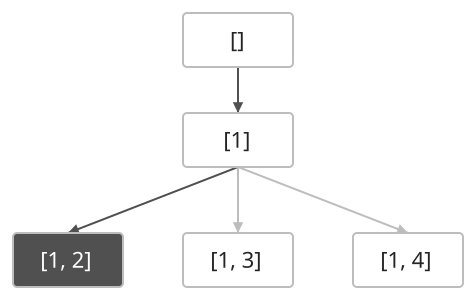
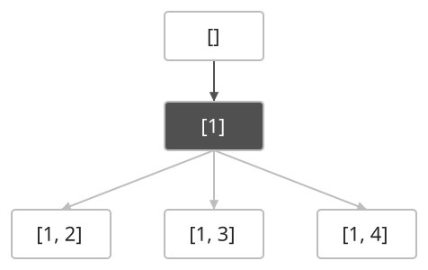
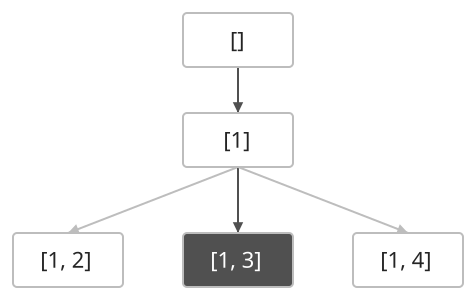
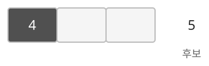

## 개념

백트래킹은 선택을 하나씩 쌓아 답을 만들고, 조건을 만족할 수 없는 선택은 더 진행하지 않는 탐색입니다. 선택 → 탐색 → 복구 순서로 다른 후보를 확인합니다.

$1,2,3,4$ 중 두 개를 고르는 조합을 만들겠습니다. 상자 안에는 지금까지 고른 수를 쓰고, 진한 상자로 현재 상태를 표시합니다. 먼저 $1$을 고른 뒤 $2$를 고르면 $[1,2]$라는 답이 완성됩니다.

답을 기록한 뒤 마지막 선택인 $2$를 제거합니다. 다음 후보를 고르기 전의 목록은 다시 $[1]$입니다.

이제 $2$ 다음 후보인 $3$을 골라 $[1,3]$을 만듭니다. $2$를 제거하지 않았다면 $[1,2,3]$이 되어 두 개를 고른다는 조건을 지킬 수 없습니다.

### 가지치기

아직 답을 완성하지 않았더라도 조건을 만족할 가능성이 사라지면 해당 탐색을 끝냅니다. $N$개 중 $R$개를 고를 때 남아 있는 후보 수가 필요한 개수보다 적으면 완성할 수 없습니다.

예를 들어 $1$부터 $5$까지 중 세 개를 오름차순으로 고를 때, 첫 수를 $4$로 골랐다면 뒤에는 $5$ 하나만 남습니다. 두 개를 더 골라야 하므로 이 분기는 완성할 수 없습니다. 이렇게 현재 상태에서 답이 나올 수 없다는 근거가 있는 경우에 탐색을 끝냅니다.

아래 그림에서 빈 두 칸은 더 골라야 하는 자리입니다. 남은 후보가 $5$ 하나뿐이므로 두 칸을 채울 수 없어, $4$를 첫 수로 고른 탐색을 끝냅니다.

### 순열·조합·부분집합

| 대상 | 다음 선택 | 종료 조건 |
|---|---|---|
| 순열 | 사용하지 않은 모든 원소 | 필요한 자리를 모두 채움 |
| 조합 | 직전에 고른 원소보다 뒤의 원소 | 필요한 개수를 모두 고름 |
| 부분집합 | 각 원소를 포함하거나 제외 | 모든 원소의 선택을 결정함 |

순열에서는 사용 표시를 했다가 재귀 호출 후 해제합니다. 조합에서는 다음 탐색의 시작 위치를 옮겨 같은 원소들을 순서만 바꾸어 다시 고르는 일을 막습니다. 부분집합은 원소마다 두 가지 선택이 있으므로 $2^N$개의 결과를 만듭니다.

### 복잡도

$N$개 중 $R$개를 고르는 모든 조합을 출력하는 경우입니다. 가지치기로 탐색량을 줄일 수 있으며, 결과를 출력하는 시간은 결과 수에 비례합니다.

| 연산 | 시간복잡도 | 공간복잡도 |
| --- | --- | --- |
| 조합 탐색·출력 | $O(R\binom NR)$ | 선택·재귀 $O(R)$ |

## 예제

### 문제

$1$부터 $N$까지의 수 중 서로 다른 $R$개를 고르는 모든 조합을 구하여라.

### 입력

첫째 줄에 수의 범위 $N$과 고를 수의 개수 $R$이 공백을 사이에 두고 주어진다. $1\le R\le N\le8$이다.

### 출력

각 조합을 한 줄에 출력한다. 한 조합의 수는 오름차순으로 공백을 사이에 두고 출력하며, 조합들은 사전순으로 출력한다.
