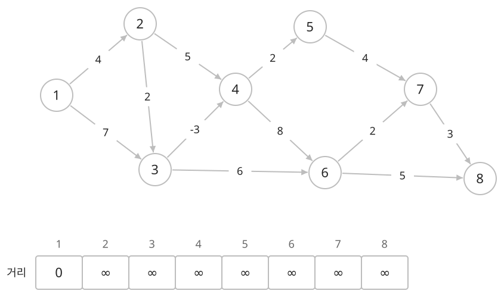
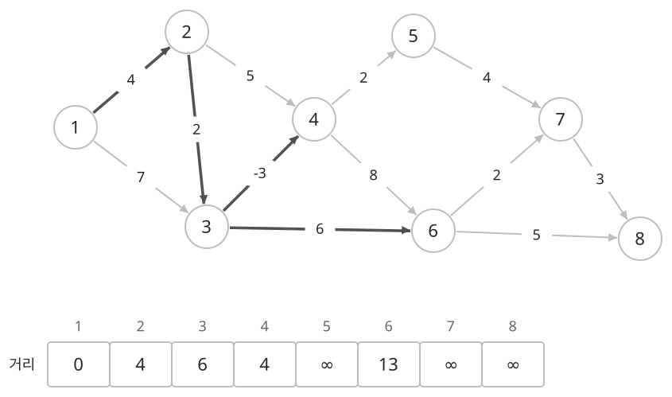
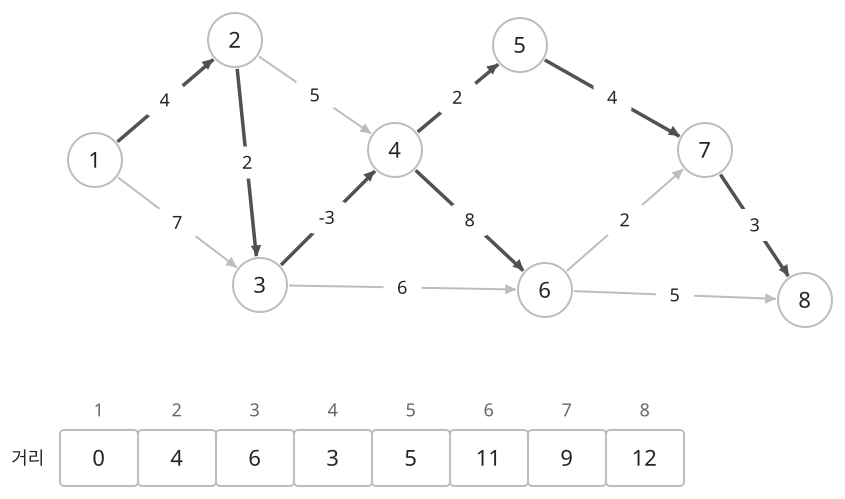
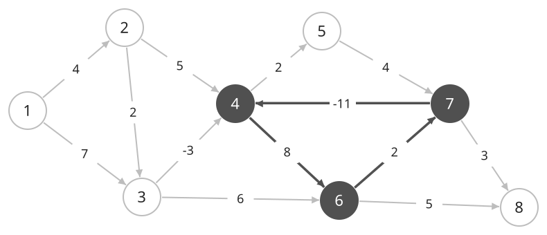

## 개념

벨만–포드는 한 시작점에서 다른 정점까지의 최단 거리를 구합니다. 다익스트라와 달리 음수 간선을 처리할 수 있고, 시작점에서 도달 가능한 음수 사이클도 찾을 수 있습니다. 비용을 차감하는 이동이 포함되거나, 이동을 반복해 비용을 계속 줄일 수 있는지 확인하는 문제에 사용합니다.

### 모든 간선을 여러 번 확인하는 이유

시작점의 거리를 $0$으로 두고, 도달한 정점에서 나가는 모든 간선을 확인합니다. $u$까지의 거리와 $u\to v$의 가중치를 더한 값이 기존의 $v$까지 거리보다 작으면 바꿉니다. 즉, 해당 간선을 거쳐 더 짧게 갈 수 있으면 저장된 거리를 갱신합니다.

정점 $8$개인 아래 그래프에서 $1$을 시작점으로 정합니다. $3\to4$의 가중치는 $-3$입니다. 아래 표는 현재 기록한 거리이고, $\infty$는 아직 경로를 찾지 못한 상태입니다.

여기서는 출발 정점 번호가 큰 간선부터 확인하고, 출발점이 같으면 도착점 번호가 큰 간선부터 확인합니다. 첫 회차에는 $1$에서 나가는 간선을 마지막에 확인하므로 $2$까지 $4$, $3$까지 $7$만 기록합니다.

두 번째 회차에서 $3\to4$를 확인하면 $7-3=4$이므로 $4$까지 거리를 $4$로 기록합니다. $3\to6$으로는 $7+6=13$을 기록합니다. 이후 $2\to3$을 확인하면서 $3$의 거리는 $4+2=6$으로 줄어듭니다.

$3$의 거리가 $6$으로 바뀐 시점에는 $3\to4$를 이미 확인했습니다. 다음 회차에서 이 간선을 다시 확인해야 $4$의 거리를 $6-3=3$으로 줄일 수 있습니다. 이렇게 바뀐 거리를 다음 정점들에 전달하며 전체 간선을 반복해서 확인합니다.

간선을 읽는 순서에 따라 한 회차에 여러 간선을 잇는 경로가 발견될 수도 있습니다. 다만 한 회차마다 적어도 간선 하나만큼 더 긴 경로까지는 반영할 수 있으므로, 간선이 $k$개 이하인 최단 경로는 $k$회 이내에 구할 수 있습니다.

### $V-1$회 반복하는 이유

정점 수를 $V$라고 하겠습니다. 음수 사이클이 없다면 같은 정점을 다시 지나는 부분을 제거해도 경로 비용이 커지지 않습니다. 따라서 최단 경로는 각 정점을 한 번씩만 지나는 형태로 고를 수 있고, 이 경로의 간선은 최대 $V-1$개입니다. 모든 간선을 $V-1$회 확인하면 이런 경로를 모두 반영할 수 있습니다.

한 회차를 마쳤는데 거리가 한 번도 바뀌지 않았다면 반복을 끝낼 수 있습니다. 이후에도 같은 거리에서 같은 간선들을 확인하므로 새로 줄어드는 거리가 생기지 않기 때문입니다.

### 음수 사이클 판별

음수 사이클은 한 바퀴의 가중치 합이 음수인 사이클입니다. 앞의 그래프에 가중치가 $-11$인 $7\to4$를 추가하면, $4\to6\to7\to4$의 비용은 $8+2-11=-1$입니다.

시작점 $1$에서 이 사이클에 도달할 수 있습니다. 한 바퀴 돌 때마다 비용이 $1$씩 줄어들므로, 반복 횟수를 늘리면 더 작은 비용의 경로를 계속 만들 수 있습니다. 이 사이클에서 도달할 수 있는 정점에는 유한한 최단 거리가 없습니다.

$V-1$회 이후 한 번 더 전체 간선을 확인했는데도 거리가 줄어든다면, 간선이 $V$개 이상인 경로를 이용해 기존 거리보다 더 짧게 갈 수 있다는 뜻입니다. 이런 경로에는 반복 방문한 정점이 있고, 비용이 계속 줄어드는 원인이 음수 사이클입니다.

시작점에서 도달한 정점의 간선만 확인하면, 시작점에서 갈 수 있는 음수 사이클을 판별합니다. 이 사이클의 영향을 받는 범위는 사이클에서 다시 도달할 수 있는 정점들입니다.

### 다익스트라와의 선택 기준

음수 간선 처리와 음수 사이클 판별이 벨만–포드의 장점입니다. 그 대신 전체 간선을 정점 수에 비례하는 횟수만큼 확인합니다. 예를 들어 정점 $500$개, 간선 $5000$개이면 약 $250$만 번의 간선 확인이 필요하지만, 정점 $100000$개, 간선 $200000$개이면 약 $200$억 번까지 늘어납니다.

따라서 음수 간선이 있는 문제에서는 먼저 정점 수와 간선 수를 함께 확인합니다. 가중치가 모두 $0$ 이상이고 한 시작점의 최단 거리가 필요하다면, 보통 우선순위 큐를 사용하는 다익스트라가 더 적은 계산을 합니다.

### 복잡도

정점 수를 $V$, 간선 수를 $E$라고 합니다.

| 연산 | 시간복잡도 | 공간복잡도 |
| --- | --- | --- |
| 최단 거리·음수 사이클 판별 | $O(VE)$ | 간선·거리 $O(V+E)$ |

## 예제

### 문제

방향 그래프에서 정점 $1$부터 각 정점까지의 최단 거리를 구하여라. 정점 $1$에서 도달할 수 있는 음수 사이클도 확인하여라.

### 입력

첫째 줄에 정점 수 $N$과 간선 수 $M$이 공백을 사이에 두고 주어진다. $1\le N\le50$; $0\le M\le200$이다.

다음 $M$개 줄에 간선의 시작점 $a$, 끝점 $b$, 가중치 $w$가 공백을 사이에 두고 주어진다. $1\le a,b\le N$; $-10\le w\le10$이다.

### 출력

정점 $1$에서 도달 가능한 음수 사이클이 있으면 `NEGATIVE CYCLE`을 출력한다. 그 외에는 정점 $1$부터 $N$까지의 최단 거리를 정점 번호 순서대로 한 줄에 공백을 사이에 두고 출력한다. 도달할 수 없는 정점의 거리는 `INF`로 출력한다.
