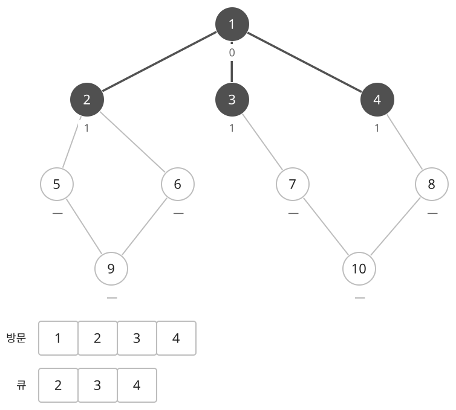
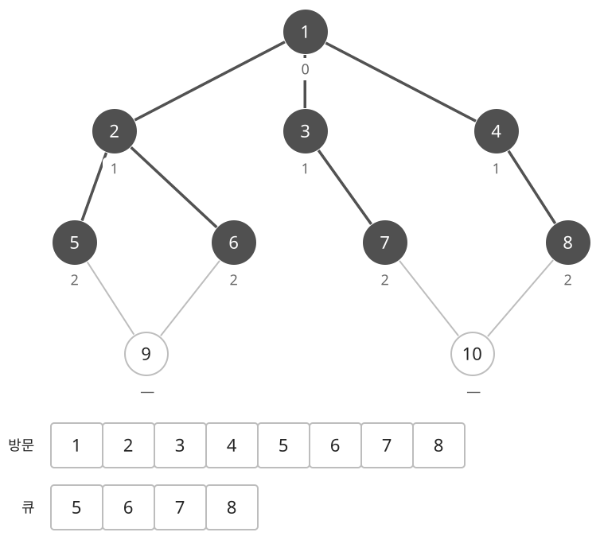
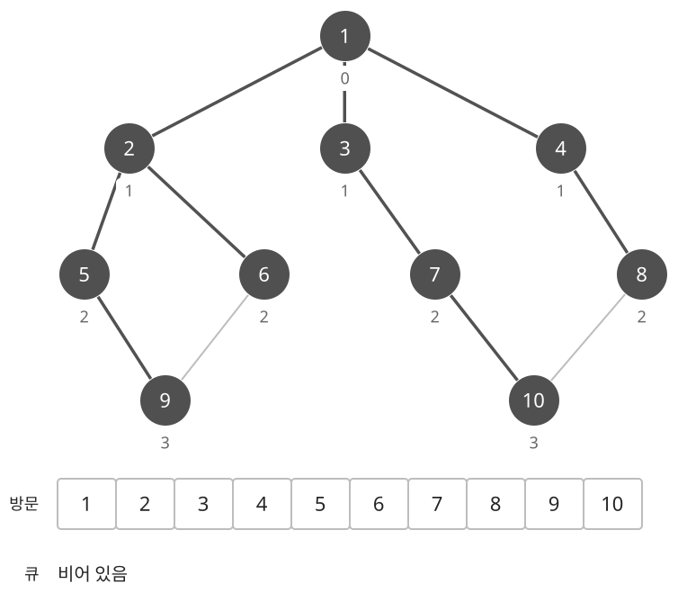

## 개념

BFS는 시작점에서 적은 횟수로 도달할 수 있는 정점부터 차례로 방문하는 탐색입니다. 먼저 발견한 정점을 먼저 처리하기 위해 큐를 사용합니다. 각 이동의 비용이 같을 때 최소 이동 횟수를 구하는 데 사용하며, 일반 그래프·격자·연산으로 바뀌는 상태에 적용할 수 있습니다.

### 거리와 방문 표시

시작점의 거리를 $0$으로 정하고 큐에 넣습니다. 큐의 맨 앞 정점을 꺼내 이웃을 확인합니다. 아직 방문하지 않은 이웃이면 현재 거리보다 $1$ 큰 거리를 기록하고 큐의 뒤에 넣습니다.

방문 표시는 큐에 넣을 때 합니다. 여러 정점에서 같은 이웃을 발견해도 처음 발견한 정점만 그 이웃을 큐에 넣으므로 중복 처리를 막을 수 있습니다.

### 같은 그래프에서 가까운 정점부터 넓히기

DFS 문서와 같은 정점 $10$개, 간선 $11$개의 무방향 그래프를 사용합니다. 시작점은 $1$이고, 모든 정점에서 작은 번호의 이웃부터 확인합니다. 방문 순서는 큐에 처음 넣으며 방문 표시를 하는 순서입니다.

진한 정점은 발견한 정점이고, 진한 간선은 각 정점을 처음 발견할 때 사용한 간선입니다. 정점 아래의 수는 시작점에서의 최소 거리이며, —는 아직 발견하지 못한 상태입니다. 큐는 왼쪽이 맨 앞입니다.

$1$을 꺼내 이웃 $2,3,4$를 모두 거리 $1$로 기록하여 큐에 넣습니다. 처음 네 정점의 방문 순서는 $1,2,3,4$입니다. DFS가 같은 그래프에서 $1\to2\to5\to9$로 내려가는 동안, BFS는 시작점과 바로 연결된 세 갈래를 모두 발견합니다.

큐에서 $2$를 꺼내 $5,6$을 거리 $2$로 기록합니다. 이때 큐는 $3,4,5,6$이므로 새로 발견한 $5$보다 기존의 $3,4$를 먼저 처리합니다. 이어서 $3$에서 $7$, $4$에서 $8$을 발견하면 큐에는 거리 $2$인 $5,6,7,8$이 남습니다.

$5$를 처리할 때 $9$를 거리 $3$으로 발견합니다. $6$에서도 $9$와 연결되어 있지만 이미 큐에 넣었으므로 다시 넣지 않습니다. $7$에서는 $10$을 거리 $3$으로 발견하고, $8$에서도 이미 발견한 $10$을 다시 넣지 않습니다. 마지막으로 $9,10$을 처리하면 탐색이 끝납니다.

### DFS와 방문 순서 비교

| 탐색 | 전체 방문 순서 | 정점 4를 처음 발견한 경로 |
| --- | --- | --- |
| DFS | $1,2,5,9,6,3,7,10,8,4$ | $1\to3\to7\to10\to8\to4$ |
| BFS | $1,2,3,4,5,6,7,8,9,10$ | $1\to4$ |

이웃을 확인하는 순서를 같게 했어도 DFS는 한 갈래를 깊게 탐색하고 돌아오며, BFS는 같은 거리의 정점을 먼저 처리합니다. 따라서 DFS의 첫 경로는 간선 $5$개를 거치지만, BFS는 $4$까지의 최소 이동 횟수 $1$을 구합니다.

### 처음 발견한 거리가 최소인 이유

거리 $1$인 정점들을 처리하면서 발견한 거리 $2$의 정점은 큐의 뒤에 들어갑니다. 따라서 거리 $1$인 정점을 모두 처리한 뒤 거리 $2$인 정점을 처리하고, 이후 거리도 같은 순서로 늘어납니다.

어떤 정점을 처음 거리 $d$에서 발견했다면, 더 적은 횟수로 도달하는 경로는 앞선 거리 단계에서 이미 확인했어야 합니다. 그래서 처음 기록한 거리가 최소 이동 횟수입니다.

간선마다 비용이 다른 경우에는 이동 횟수와 총비용이 다릅니다. 직접 가는 한 간선의 비용이 $10$이고 두 간선을 거치는 비용이 $1+1=2$라면, 이동 횟수가 적은 경로가 더 비쌉니다. 이런 최단 비용 문제에서는 가중치 조건에 맞는 최단 경로 알고리즘을 선택합니다.

무방향 그래프에서 아직 방문하지 않은 정점마다 BFS를 시작하면 연결 요소도 셀 수 있습니다. 한 번의 BFS가 해당 시작점에서 도달 가능한 정점을 모두 방문하기 때문입니다.

### 복잡도

정점 수를 $N$, 간선 수를 $M$이라고 합니다. 인접 리스트로 간선을 저장하고 각 정점을 한 번씩 방문합니다.

| 연산 | 시간복잡도 | 공간복잡도 |
| --- | --- | --- |
| 탐색 | $O(N+M)$ | $O(N+M)$ |

## 예제

### 문제

무방향 그래프에서 정점 $1$부터 정점 $N$까지 이동할 때 거치는 간선 수의 최솟값을 구하여라.

### 입력

첫째 줄에 정점 수 $N$과 간선 수 $M$이 공백을 사이에 두고 주어진다. $1\le N\le100$; $0\le M\le N(N-1)/2$이다.

다음 $M$개 줄에 간선의 양 끝점 $a,b$가 공백을 사이에 두고 주어진다. $1\le a,b\le N$; $a\ne b$이다. 중복 간선은 없다.

### 출력

거치는 간선 수의 최솟값을 출력한다. 도달할 수 없으면 `-1`을 출력한다.
