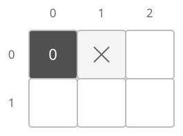
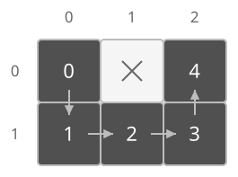

## 개념

BFS는 큐를 사용하여 시작점에서 적은 횟수로 도달하는 곳부터 방문합니다. 각 이동의 비용이 같을 때 최소 이동 횟수를 구합니다.

### 이웃 좌표와 이동 조건

격자의 칸을 정점으로 보고, 한 번에 이동 가능한 두 칸 사이에 간선이 있다고 생각합니다. 현재 좌표가 $(r,c)$이고 상하좌우로 한 칸씩 이동할 수 있다면 이웃은 다음과 같습니다.

| 방향 | 다음 좌표 | 행 변화량 | 열 변화량 |
| --- | --- | --- | --- |
| 위 | $(r-1,c)$ | $-1$ | $0$ |
| 오른쪽 | $(r,c+1)$ | $0$ | $1$ |
| 아래 | $(r+1,c)$ | $1$ | $0$ |
| 왼쪽 | $(r,c-1)$ | $0$ | $-1$ |

행·열 변화량을 같은 순서의 방향 배열로 저장하면 반복해서 이웃을 구할 수 있습니다. $0$부터 번호를 매기는 $R\times C$ 격자에서 다음 좌표 $(r',c')$가 $0\le r'<R$, $0\le c'<C$ 안에 있는지 먼저 확인합니다. 그 뒤에 벽인지와 방문한 칸인지를 확인합니다.

대각선 이동도 허용된다면 대각선 네 방향을 추가하고, 한 번의 대각선 이동 비용도 다른 방향과 같을 때 같은 BFS를 적용합니다.

### 최소 이동 횟수

시작 칸을 거리 $0$으로 큐에 넣습니다. 아직 방문하지 않은 이동 가능한 이웃 칸을 발견하면 현재 칸의 거리보다 $1$ 큰 값을 기록합니다. 각 이동이 한 칸이므로 일반 그래프와 같은 이유로 최초 거리가 최소 이동 횟수입니다.

다음 격자의 시작점은 $(0,0)$이며, 벽을 피해 상하좌우로 한 칸씩 이동합니다.

그림에서는 벽을 ×로 표시합니다. 진한 칸은 발견한 칸이며, 칸 안의 수는 시작점에서 이동한 최소 횟수입니다. 시작점의 거리를 $0$으로 기록합니다.

$(0,0)$에서 오른쪽은 벽이므로 아래의 $(1,0)$을 거리 $1$로 발견합니다. 이어서 $(1,1)$은 거리 $2$, $(1,2)$는 거리 $3$, $(0,2)$는 거리 $4$로 발견합니다. 좌표가 가까워 보여도 벽을 피해 가야 하므로 실제 이동 가능한 경로를 따라 거리를 구합니다.

오른쪽 아래 $(1,2)$까지의 최소 이동 횟수는 $3$입니다. 큐가 빌 때까지 탐색해도 도착 칸을 방문하지 못했다면 그 칸으로 가는 경로가 없습니다.

### 복잡도

행 수를 $R$, 열 수를 $C$라고 합니다. 각 칸을 한 번씩 방문하며 네 방향을 확인합니다.

| 연산 | 시간복잡도 | 공간복잡도 |
| --- | --- | --- |
| 탐색 | $O(RC)$ | $O(RC)$ |

## 예제

### 문제

격자의 왼쪽 위에서 오른쪽 아래로 이동하는 최소 횟수를 구하여라. 상하좌우로 한 칸씩 이동할 수 있다.

### 입력

첫째 줄에 행 수 $R$과 열 수 $C$가 공백을 사이에 두고 주어진다. $1\le R,C\le30$이다.

다음 $R$개 줄에 각 행의 칸을 나타내는 정수 $C$개가 공백을 사이에 두고 주어진다. 각 값은 $0$ 또는 $1$이며, $1$은 이동 가능한 칸, $0$은 벽이다. 시작 칸과 도착 칸은 $1$이다.

### 출력

최소 이동 횟수를 출력한다. 도달할 수 없으면 `-1`을 출력한다.
