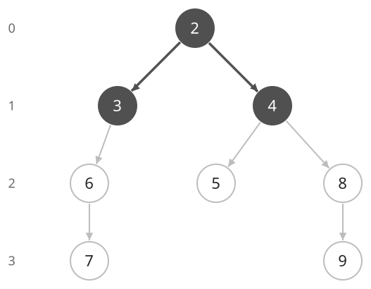
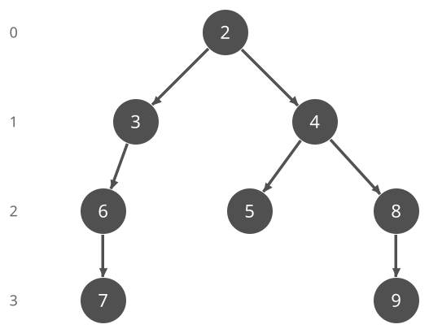

## 개념

BFS는 큐를 사용하여 시작점에서 적은 횟수로 도달하는 곳부터 방문합니다. 각 이동의 비용이 같을 때 최소 이동 횟수를 구합니다.

### 연산을 간선으로 표현하기

숫자 $x$에서 $x+1$ 또는 $2x$로 바꿀 수 있고, 숫자는 $1$부터 $9$까지만 허용된다고 하겠습니다. 숫자 하나가 정점이고, 한 번의 연산이 다음 숫자로 향하는 간선입니다. 각 연산의 비용을 한 번으로 세므로 BFS로 목표 숫자까지의 최소 연산 횟수를 구할 수 있습니다.

$2$에서 시작하면 한 번의 연산으로 $3$이나 $4$가 됩니다. $3$에서는 $4$와 $6$을 만들 수 있지만 $4$는 이미 한 번 만에 도달했으므로 다시 넣지 않습니다. $4$에서는 $5$와 $8$을 새로 발견합니다. 허용 범위를 벗어나는 결과는 제외합니다.

그림은 같은 횟수로 처음 도달하는 상태를 한 줄에 놓았습니다. 왼쪽 숫자는 연산 횟수이고, 진한 정점은 발견한 상태입니다. 화살표는 각 상태를 처음 발견한 경로를 나타냅니다.

| 최소 연산 횟수 | 처음 도달하는 상태 |
| --- | --- |
| $0$ | $2$ |
| $1$ | $3,4$ |
| $2$ | $5,6,8$ |
| $3$ | $7,9$ |

$9$는 $2\to4\to8\to9$로 $3$번 만에 도달합니다. $0,1,2$번의 연산으로 갈 수 있는 상태를 모두 확인했을 때 $9$가 없었으므로, 이보다 적은 횟수로는 도달할 수 없습니다.

### 방문 상태의 구분

현재 숫자만으로 다음 연산이 정해지는 문제에서는 숫자를 기준으로 방문을 기록합니다. 서로 다른 경로로 같은 숫자를 만들어도 이후에 가능한 연산은 같고, BFS의 첫 도달 횟수가 최소이므로 나중 경로로 다시 탐색할 필요가 없습니다.

상태에 따라 사용할 수 있는 연산이 달라지면 그 정보도 포함해야 합니다. 예를 들어 두 배 연산을 한 번만 쓸 수 있다면, 숫자 $4$에 도달했더라도 그 연산을 이미 쓴 상태와 아직 쓸 수 있는 상태는 서로 다릅니다. 이 경우에는 `(현재 숫자, 두 배 연산 사용 여부)`를 하나의 상태로 구분합니다.

### 복잡도

방문 가능한 상태 수를 $S$, 각 상태에서 확인하는 연산 수의 최댓값을 $K$라고 합니다. 각 상태는 처음 방문할 때 표시합니다.

| 연산 | 시간복잡도 | 공간복잡도 |
| --- | --- | --- |
| 탐색 | $O(SK)$ | $O(S)$ |

## 예제

### 문제

정수 $A$에서 시작하여 현재 수에 $1$을 더하거나 $2$를 곱할 수 있다. 연산 결과는 $1$부터 $100$까지여야 한다. 정수 $B$에 도달하는 최소 연산 횟수를 구하여라.

### 입력

첫째 줄에 시작 정수 $A$와 목표 정수 $B$가 공백을 사이에 두고 주어진다. $1\le A,B\le100$이다.

### 출력

최소 연산 횟수를 출력한다. 도달할 수 없으면 `-1`을 출력한다. 처음부터 두 수가 같으면 `0`을 출력한다.
