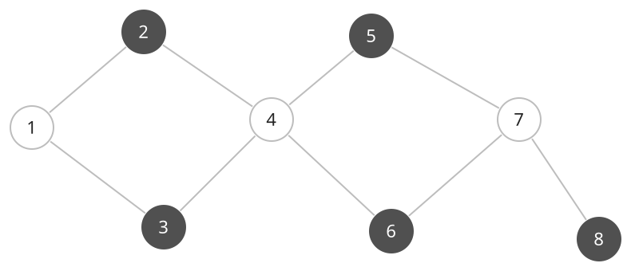

## 개념

### 이분 그래프 판별

이분 그래프는 정점을 두 집합으로 나누었을 때 모든 간선의 양 끝점이 서로 다른 집합에 속하는 그래프입니다. 각 집합에 색을 하나씩 정하면, 인접한 정점의 색이 서로 달라야 합니다.

시작 정점에 색을 지정하고 BFS 또는 DFS로 이웃에 반대 색을 지정합니다. 이미 색이 있는 이웃의 색이 현재 정점과 같으면 이분 그래프가 아닙니다. 연결 요소마다 이 과정을 수행합니다.

아래 그래프에는 정점 $8$개와 간선 $9$개가 있습니다. $1$을 흰색으로 정하면 이웃 $2,3$은 진한 회색입니다. $2,3$과 연결된 $4$는 흰색이고, 이 과정을 반복하면 두 그룹은 $\{1,4,7\}$과 $\{2,3,5,6,8\}$입니다.

이 그래프에는 $1\to2\to4\to3\to1$, $4\to5\to7\to6\to4$처럼 길이가 짝수인 사이클이 있습니다. 사이클을 따라 두 색을 번갈아 지정해도 마지막 간선의 양 끝이 다른 색이므로 조건을 만족합니다.

여기에 $3$과 $6$을 잇는 간선을 추가하면 두 끝점이 모두 진한 회색입니다. $3\to4\to6\to3$은 길이가 $3$인 홀수 사이클이므로 두 색을 번갈아 지정할 수 없습니다. 문제가 되는 간선을 점선과 ×로 표시합니다.

따라서 사이클이 있어도 길이가 모두 짝수이면 이분 그래프가 될 수 있고, 홀수 사이클이 하나라도 있으면 이분 그래프가 아닙니다.

시작 정점의 그룹을 바꿔도 이 연결 요소 전체의 두 그룹 이름만 뒤바뀝니다. 인접한 정점이 반대 그룹이어야 한다는 조건은 그대로이므로, 탐색 중 같은 그룹끼리 연결된 간선을 발견했다면 시작 색을 바꾸어 해결할 수 없습니다. 서로 연결되지 않은 요소는 각자 새 시작점에서 검사합니다.

### 복잡도

정점 수를 $V$, 간선 수를 $E$라고 합니다.

| 연산 | 시간복잡도 | 공간복잡도 |
| --- | --- | --- |
| 인접 리스트 이분 그래프 판별 | $O(V+E)$ | 그래프 $O(V+E)$, 추가 $O(V)$ |

## 예제

### 문제

주어진 무방향 그래프가 이분 그래프인지 판별하여라.

### 입력

첫째 줄에 정점 수 $N$과 간선 수 $M$이 공백을 사이에 두고 주어진다. $1\le N\le100$; $0\le M\le200$이다.

다음 $M$개 줄에 간선의 양 끝점 $a,b$가 공백을 사이에 두고 주어진다. $1\le a,b\le N$이다.

### 출력

이분 그래프이면 `YES`, 아니면 `NO`를 출력한다.
