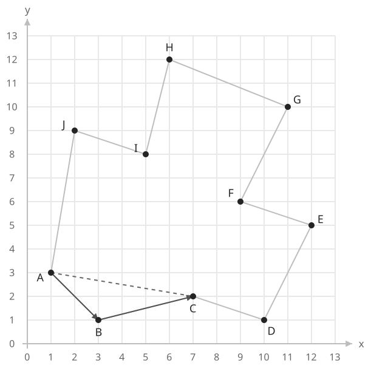
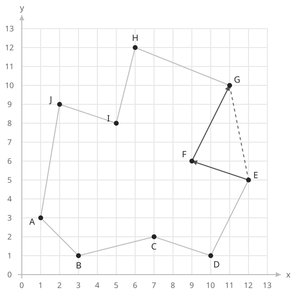
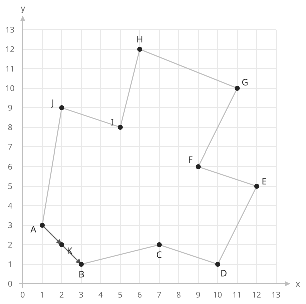

## 개념

### 벡터와 외적

점 $A=(x_A,y_A)$에서 $B=(x_B,y_B)$로 향하는 벡터는 $\overrightarrow{AB}=(x_B-x_A,y_B-y_A)$입니다. 두 벡터의 덧셈과 뺄셈은 각 좌표끼리 계산합니다.

평면 벡터 $u=(u_x,u_y)$와 $v=(v_x,v_y)$의 외적은 다음 값으로 나타냅니다.

$$
u\times v=u_xv_y-u_yv_x
$$

절댓값은 두 벡터가 만드는 평행사변형의 넓이이며, 부호는 두 벡터의 회전 방향을 나타냅니다.

### 세 점의 방향 판별

세 점 $A$, $B$, $C$의 방향은 $\overrightarrow{AB}\times\overrightarrow{AC}$의 부호로 판별합니다. 이를 CCW 판별이라고 합니다.

| 외적의 부호 | A → B → C 방향 |
| --- | --- |
| 양수 | 반시계 방향 |
| 0 | 일직선 |
| 음수 | 시계 방향 |

다음 오목한 $10$각형에서 경계를 따라 세 점을 선택해 보겠습니다. 회색 선은 다각형 전체이고, 화살표는 방향을 판별할 세 점의 연결 순서입니다.

$A=(1,3)$, $B=(3,1)$, $C=(7,2)$이면 $\overrightarrow{AB}=(2,-2)$, $\overrightarrow{AC}=(6,-1)$입니다. 외적은 $2\times(-1)-(-2)\times6=10$이므로 $A\to B\to C$는 반시계 방향입니다.

같은 다각형의 $E=(12,5)$, $F=(9,6)$, $G=(11,10)$을 선택하면 $\overrightarrow{EF}=(-3,1)$, $\overrightarrow{EG}=(-1,5)$입니다. 외적은 $(-3)\times5-1\times(-1)=-14$이므로 $E\to F\to G$는 시계 방향입니다. $F$는 다각형 안쪽으로 들어간 꼭짓점입니다.

변 $AB$ 위에 $K=(2,2)$를 놓으면 $A\to K\to B$의 외적은 $1\times(-2)-(-1)\times2=0$입니다. 세 점이 일직선에 놓이는지는 선분의 기울기와 관계없이 외적으로 확인할 수 있습니다.

기준점 $A$의 좌표를 빼서 두 벡터를 만들면 $A$를 원점으로 옮겨 생각할 수 있습니다. 외적의 절댓값은 평행사변형의 넓이이고, 두 벡터가 놓인 순서를 바꾸면 부호가 반대가 됩니다. 이 부호로 직선의 어느 쪽에 점이 있는지를 판정합니다. 곱셈과 뺄셈으로 계산하므로 수직선에서도 기울기를 나누어 구할 필요가 없습니다.

### 복잡도

고정된 세 점을 기준으로 합니다.

| 연산 | 시간복잡도 | 공간복잡도 |
| --- | --- | --- |
| CCW 판별 | $O(1)$ | 추가 $O(1)$ |

## 예제

### 문제

세 점을 주어진 순서대로 연결할 때의 방향을 판별하여라.

### 입력

첫째 줄부터 셋째 줄까지 점 $A,B,C$의 좌표가 순서대로 주어진다. 각 줄에는 해당 점의 $x$좌표와 $y$좌표가 공백을 사이에 두고 주어진다. 각 좌표는 $0$ 이상 $100$ 이하의 정수이다.

### 출력

반시계 방향이면 $1$, 일직선이면 $0$, 시계 방향이면 $-1$을 출력한다.
