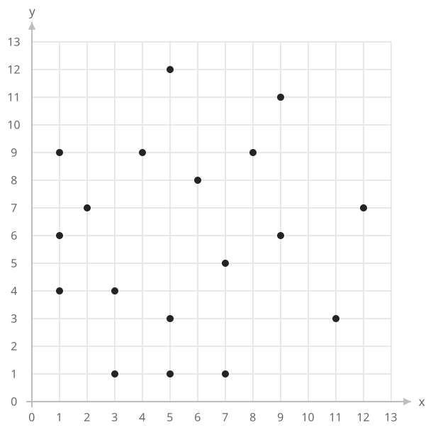
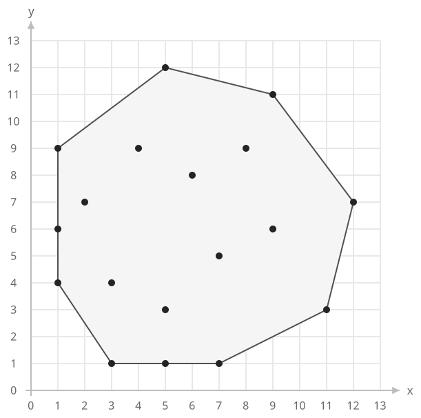
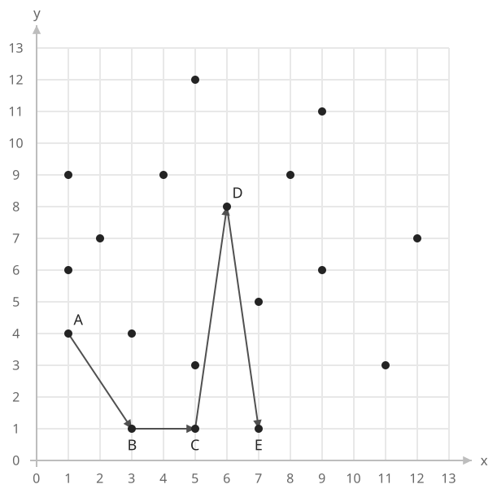
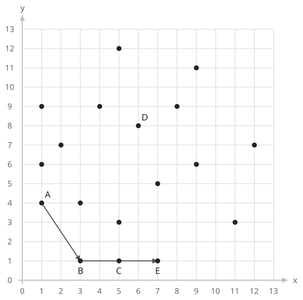

## 개념

### 볼록 껍질

볼록 껍질은 주어진 모든 점을 포함하는 가장 작은 볼록 영역의 경계입니다. 볼록 다각형에서는 내부의 두 점을 연결한 선분 전체가 다각형 안에 놓입니다.

점들을 둘러싸는 외곽 꼭짓점이 필요할 때 볼록 껍질을 구합니다. 내부에 있는 점은 껍질의 꼭짓점에 포함되지 않습니다. 한 변 위에 여러 점이 있으면 양 끝점만 꼭짓점으로 기록합니다.

다음 $18$개 점에는 외곽의 꼭짓점이 될 점 $8$개, 외곽의 변 위에 놓인 점 $2$개, 내부 점 $8$개가 섞여 있습니다. 가로·세로 방향뿐 아니라 비스듬한 경계도 찾아야 합니다.

가장 왼쪽 아래 점 $(1,4)$에서 시작하면 볼록 껍질의 꼭짓점은 다음 순서입니다.

$$
(1,4)\to(3,1)\to(7,1)\to(11,3)\to(12,7)\to(9,11)\to(5,12)\to(1,9).
$$

마지막 점을 다시 $(1,4)$에 연결하면 모든 점을 포함하는 볼록 $8$각형이 됩니다. $(5,1)$과 $(1,6)$은 각각 아래쪽과 왼쪽 변 위에 있으므로 해당 변의 양 끝점만 기록합니다. $(6,8)$, $(9,6)$ 등을 포함한 나머지 $8$개 점은 경계 안에 있습니다.

### 모노톤 체인

먼저 점을 $x$좌표가 작은 순서, 같으면 $y$좌표가 작은 순서로 정렬하고 중복점을 합칩니다.

왼쪽부터 점을 확인하며 아래쪽 경계를 만듭니다. 마지막 두 점과 새 점이 반시계 방향을 이루도록 유지합니다. 시계 방향이거나 일직선이면 마지막 점을 제거한 뒤 다시 방향을 확인합니다. 반대 순서로 같은 과정을 수행하면 위쪽 경계를 얻습니다.

아래쪽 경계와 위쪽 경계의 중복 끝점을 한 번씩 제외하고 연결하면 반시계 방향의 볼록 껍질을 얻습니다. 모든 점이 일직선이면 양 끝점이 남고, 서로 다른 점이 하나이면 그 점이 껍질입니다.

### 경계에서 마지막 점을 제거하는 이유

같은 $18$개 점을 정렬해 아래쪽 경계를 만드는 중이라고 하겠습니다. 현재 후보 목록은 $A=(1,4)$, $B=(3,1)$, $C=(5,1)$, $D=(6,8)$이고, 다음으로 $E=(7,1)$을 확인합니다.

먼저 마지막 두 점 $C,D$와 새 점 $E$를 확인합니다. 외적은 $1\times0-7\times2=-14$로 시계 방향입니다. $D$를 거치면 아래쪽 경계가 위로 들어가므로 $D$를 제거합니다.

그다음에는 새로 마지막 두 점이 된 $B,C$와 $E$를 확인합니다. 세 점의 $y$좌표가 모두 $1$이므로 외적이 $0$입니다. 가운데 점 $C$를 제거하면 한 변의 양 끝점 $B,E$가 남습니다. 마지막으로 $A,B,E$의 외적은 $12$로 양수이므로 검사를 끝냅니다.

이 과정처럼 새 점 하나를 추가하면서 여러 후보를 제거할 수 있습니다. 한 점을 제거할 때마다 마지막 두 점이 바뀌므로 방향을 다시 확인합니다. 제거는 현재 경계 목록에서 수행하며, 위쪽 경계를 만들 때는 전체 점을 반대 순서로 다시 검사합니다.

점들을 모두 포함하는 외곽 다각형의 넓이나 경계가 필요할 때 먼저 볼록 껍질을 구할 수 있습니다. 원래 오목한 다각형의 넓이를 구하는 문제에서는 원래 꼭짓점 순서에 신발끈 공식을 적용합니다. 볼록 껍질을 구하면 오목하게 들어간 부분까지 포함하는 다른 영역이 됩니다.

### 복잡도

점의 수를 $N$이라고 합니다. 각 점은 경계에 한 번 들어가고 최대 한 번 제거됩니다.

| 연산 | 시간복잡도 | 공간복잡도 |
| --- | --- | --- |
| 점 정렬 | $O(N\log N)$ | 점 저장 $O(N)$ |
| 아래쪽·위쪽 경계 구성 | $O(N)$ | 경계 저장 $O(N)$ |

## 예제

### 문제

주어진 점들의 볼록 껍질 꼭짓점을 구하여라.

### 입력

첫째 줄에 점의 수 $N$이 주어진다. $1\le N\le100$이다.

다음 $N$개 줄에 각 점의 $x$좌표와 $y$좌표가 공백을 사이에 두고 주어진다. 각 좌표는 $0$ 이상 $100$ 이하의 정수이다. 같은 점이 여러 번 주어질 수 있다.

### 출력

첫째 줄에 볼록 껍질의 꼭짓점 수를 출력한다. 다음 줄부터 각 꼭짓점의 $x$좌표와 $y$좌표를 공백을 사이에 두고 한 줄에 출력한다. $x$좌표가 가장 작고, 같으면 $y$좌표가 가장 작은 점부터 반시계 방향으로 출력한다. 한 변 위의 점은 양 끝점만 출력한다. 서로 다른 점이 하나이면 그 점을, 모두 일직선이면 양 끝점을 출력한다.
