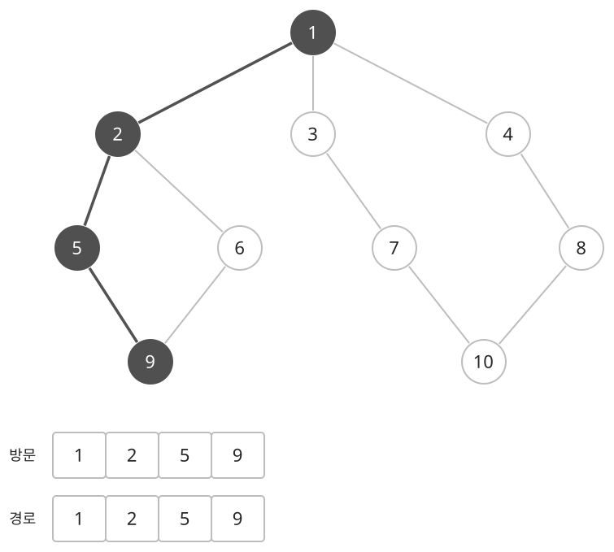
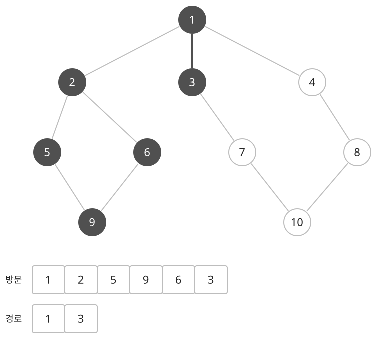
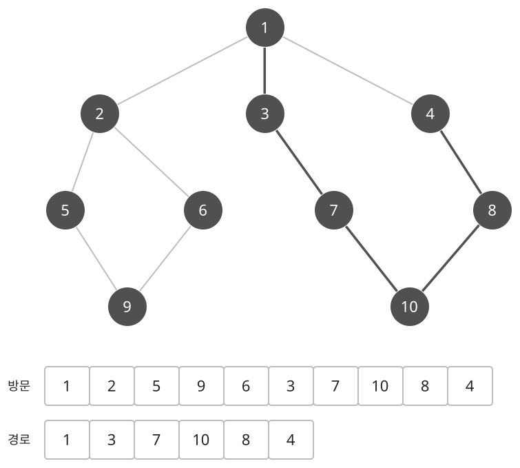

## 개념

DFS는 아직 방문하지 않은 이웃을 따라 깊게 이동하고, 더 이동할 곳이 없으면 이전 위치로 돌아오는 탐색입니다. 재귀 호출이나 스택으로 돌아갈 위치를 관리합니다. 정점과 간선이 주어진 일반 그래프뿐 아니라 격자의 칸, 연산으로 바뀌는 상태도 같은 방식으로 탐색할 수 있습니다.

### 방문 순서와 방문 표시

각 정점에 연결된 이웃을 확인하고, 아직 방문하지 않은 정점으로 이동합니다. 새 정점에 도착하면 방문 표시를 한 뒤 그 정점의 이웃을 탐색합니다. 이미 방문한 정점으로 이어지는 간선은 건너뜁니다.

### 같은 그래프에서 깊게 내려가기

BFS 문서와 같은 정점 $10$개, 간선 $11$개의 무방향 그래프를 사용합니다. 시작점은 $1$이고, 모든 정점에서 작은 번호의 이웃부터 확인합니다. 여기서 방문 순서는 정점에 처음 방문 표시를 하는 순서입니다.

진한 정점은 방문한 정점이고, 진한 간선은 현재 재귀 호출 경로입니다. 아래의 방문 목록은 처음 발견한 순서, 경로 목록은 아직 끝나지 않은 재귀 호출을 나타냅니다.

$1$에는 $2,3,4$가 연결되어 있습니다. DFS는 먼저 $2$로 이동한 뒤 $1$의 다음 이웃을 확인하기 전에 $2$의 탐색을 진행합니다. $2$에서 $5$, $5$에서 $9$로 내려가므로 처음 네 정점은 $1,2,5,9$입니다.

$9$에서는 방문한 $5$를 건너뛰고 $6$으로 이동합니다. $6$의 이웃 $2,9$는 모두 방문했으므로 더 내려가지 않고 돌아옵니다. $6\to9\to5\to2\to1$ 순서로 재귀 호출이 끝나며, $2$의 다른 이웃인 $6$도 이미 방문했으므로 다시 들어가지 않습니다. 이제 $1$의 다음 이웃 $3$을 방문합니다.

$3$부터는 $7\to10\to8\to4$로 이동합니다. 정점 $4$는 시작점 $1$과 직접 연결되어 있지만, DFS는 먼저 선택한 갈래를 끝까지 탐색하므로 이 예에서는 가장 마지막에 발견합니다.

### BFS와 방문 순서 비교

| 탐색 | 처음 네 정점 | 전체 방문 순서 |
| --- | --- | --- |
| DFS | $1,2,5,9$ | $1,2,5,9,6,3,7,10,8,4$ |
| BFS | $1,2,3,4$ | $1,2,3,4,5,6,7,8,9,10$ |

DFS가 처음 $4$를 발견한 경로는 $1\to3\to7\to10\to8\to4$로 간선 $5$개를 거칩니다. 하지만 $1\to4$로 바로 이동하면 간선 $1$개면 충분합니다. DFS의 첫 발견 경로는 이웃을 확인하는 순서에 따라 정해지므로 최소 이동 횟수를 보장하지 않습니다. BFS는 시작점과 가까운 정점부터 방문하므로 $4$의 거리를 처음부터 $1$로 구합니다.

방문 표시는 이웃 탐색보다 먼저 합니다. 무방향 간선 $1\leftrightarrow2$에서 $1$의 표시가 없다면 $2$가 다시 $1$을 새 정점으로 판단할 수 있기 때문입니다. 사이클이 있어도 각 정점을 한 번씩 방문하도록 하면 탐색을 마칠 수 있습니다.

### 연결 요소

한 번의 DFS는 시작점에서 도달할 수 있는 정점을 모두 방문합니다. 무방향 그래프에서 전체 정점을 살펴보며 아직 방문하지 않은 정점마다 DFS를 시작하면, 시작한 횟수가 연결 요소의 개수입니다.

간선이 $(1,2),(2,3),(4,5)$이고 정점이 $6$개라면, $1$에서 시작한 DFS는 $\{1,2,3\}$을 방문합니다. 다음 미방문 정점 $4$에서는 $\{4,5\}$를 방문하고, $6$은 혼자 하나의 연결 요소를 이룹니다. 연결 요소는 총 $3$개입니다.

### 복잡도

정점 수를 $N$, 간선 수를 $M$이라고 합니다. 인접 리스트로 간선을 저장하고 각 정점을 한 번씩 방문합니다.

| 연산 | 시간복잡도 | 공간복잡도 |
| --- | --- | --- |
| 탐색 | $O(N+M)$ | $O(N+M)$ |

재귀 호출은 탐색 경로가 길어질수록 깊어집니다. 깊은 탐색에서는 재귀 호출 대신 직접 만든 스택에 탐색할 위치를 저장할 수 있습니다.

## 예제

### 문제

무방향 그래프의 연결 요소 개수를 구하여라.

### 입력

첫째 줄에 정점 수 $N$과 간선 수 $M$이 공백을 사이에 두고 주어진다. $1\le N\le100$; $0\le M\le N(N-1)/2$이다.

다음 $M$개 줄에 간선의 양 끝점 $a,b$가 공백을 사이에 두고 주어진다. $1\le a,b\le N$; $a\ne b$이다. 중복 간선은 없다.

### 출력

연결 요소의 개수를 출력한다.
