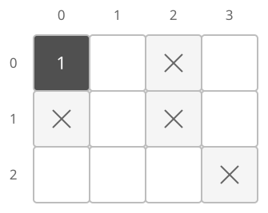
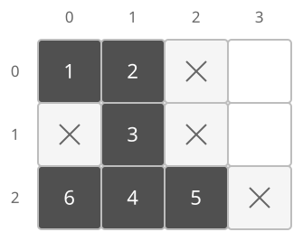

## 개념

DFS는 방문하지 않은 이웃으로 이동하고, 더 갈 곳이 없으면 이전 위치로 돌아오는 탐색입니다.

### 칸과 이동을 정점과 간선으로 표현하기

격자의 한 칸을 정점으로 보고, 한 번에 이동할 수 있는 두 칸 사이에 간선이 있다고 생각합니다. 좌표를 $(r,c)$로 나타내면 $r$은 행, $c$는 열입니다. 상하좌우로 이동할 수 있을 때 이웃 좌표는 다음과 같습니다.

| 방향 | 다음 좌표 | 행 변화량 | 열 변화량 |
| --- | --- | --- | --- |
| 위 | $(r-1,c)$ | $-1$ | $0$ |
| 오른쪽 | $(r,c+1)$ | $0$ | $1$ |
| 아래 | $(r+1,c)$ | $1$ | $0$ |
| 왼쪽 | $(r,c-1)$ | $0$ | $-1$ |

이 변화량을 방향 배열에 같은 순서로 저장하면 네 이웃을 차례로 구할 수 있습니다. 대각선 이동도 허용된 문제에서는 $(-1,-1)$, $(-1,1)$, $(1,-1)$, $(1,1)$의 변화량을 추가합니다.

행과 열의 번호가 $0$부터 시작하는 $R\times C$ 격자에서 다음 좌표 $(r',c')$는 $0\le r'<R$, $0\le c'<C$를 만족해야 합니다. 먼저 범위를 확인하고, 그 안에 있는 칸이 이동 가능한지와 아직 방문하지 않았는지를 확인합니다. 격자 밖의 칸은 배열에서 읽을 수 없으므로 범위 검사가 먼저입니다.

### 연결된 영역 탐색

다음 격자에서 상하좌우로 한 칸씩 이동하며, 벽을 통과할 수 없다고 하겠습니다.

그림에서는 벽을 ×로 표시합니다. 진한 칸은 방문한 칸이며, 칸 안의 숫자는 방문 순서입니다. 위쪽 번호는 열, 왼쪽 번호는 행입니다. $(0,0)$을 첫 번째로 방문합니다.

$(0,0)$에서 시작하면 $(0,1)$, $(1,1)$, $(2,1)$로 내려간 뒤 $(2,2)$와 $(2,0)$도 방문할 수 있습니다. 이 영역의 칸은 $6$개입니다. 오른쪽의 $(0,3)$과 $(1,3)$은 벽으로 분리되어 있어 별도로 탐색합니다.

위·오른쪽·아래·왼쪽 순서로 확인하면 $(2,2)$를 다섯 번째로 방문합니다. 이후 $(2,1)$로 돌아와 왼쪽의 $(2,0)$을 여섯 번째로 방문합니다. 그림의 $5$번 칸에서 $6$번 칸으로 바로 이동하는 것은 아닙니다.

방문한 칸 수를 세면 영역의 넓이를 구할 수 있고, 아직 방문하지 않은 이동 가능한 칸마다 DFS를 시작하면 영역의 개수를 구할 수 있습니다. 위 격자의 영역은 $2$개입니다.

### 복잡도

행 수를 $R$, 열 수를 $C$라고 합니다. 각 칸을 한 번씩 방문하며 네 방향을 확인합니다.

| 연산 | 시간복잡도 | 공간복잡도 |
| --- | --- | --- |
| 탐색 | $O(RC)$ | $O(RC)$ |

재귀 호출은 탐색 경로가 길어질수록 깊어집니다. 깊은 탐색에서는 재귀 호출 대신 직접 만든 스택에 탐색할 위치를 저장할 수 있습니다.

## 예제

### 문제

상하좌우로 연결된 영역의 개수를 구하여라. 이동 가능한 칸끼리 이어져 있으면 같은 영역이다.

### 입력

첫째 줄에 행 수 $R$과 열 수 $C$가 공백을 사이에 두고 주어진다. $1\le R,C\le20$이다.

다음 $R$개 줄에 각 행의 칸을 나타내는 정수 $C$개가 공백을 사이에 두고 주어진다. 각 값은 $0$ 또는 $1$이며, $1$은 이동 가능한 칸, $0$은 벽이다.

### 출력

영역의 개수를 출력한다.
