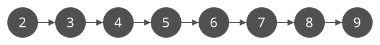
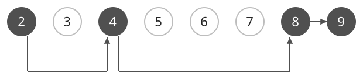

## 개념

DFS는 방문하지 않은 이웃으로 이동하고, 더 갈 곳이 없으면 이전 위치로 돌아오는 탐색입니다.

### 상태와 가능한 연산

현재 숫자에 $1$을 더하거나 $2$를 곱할 수 있고, 숫자는 $1$부터 $9$까지만 허용된다고 하겠습니다. 이 문제에서는 현재 숫자가 정점이고, 한 번의 연산이 방향 간선입니다.

| 현재 상태 | 가능한 다음 상태 |
| --- | --- |
| $2$ | $3$, $4$ |
| $3$ | $4$, $6$ |
| $4$ | $5$, $8$ |
| $8$ | $9$ |

$8$에 $2$를 곱한 $16$은 허용 범위를 벗어나므로 다음 상태에서 제외합니다. 모든 간선을 미리 저장하는 대신 현재 상태에 연산을 적용해 다음 상태를 구할 수 있습니다.

### 도달 가능한 상태 찾기

$2$에서 $9$에 도달할 수 있는지 DFS로 확인할 때, $1$을 더하는 연산부터 선택하면 $2\to3\to4\to5\to6\to7\to8\to9$ 순서로 탐색합니다. 목표 상태 $9$를 방문했으므로 도달 가능하다는 답을 얻습니다. 가능한 모든 상태가 필요하다면 남은 연산도 계속 탐색합니다.

서로 다른 연산 경로로 같은 숫자에 도달해도 그 뒤에 할 수 있는 연산은 같습니다. 따라서 현재 숫자를 기준으로 방문 표시를 하면 그 숫자에서 시작하는 탐색을 반복하지 않습니다. 남은 연산 횟수에 따라 가능한 선택이 달라지는 문제라면 숫자와 남은 횟수를 함께 상태로 구분해야 합니다.

처음 발견한 경로의 연산 횟수는 $7$번이지만, $2\to4\to8\to9$는 $3$번입니다. DFS는 한 갈래를 먼저 끝까지 탐색하므로 목표에 도달할 수 있는지 확인하거나 도달 가능한 모든 상태를 찾는 데 사용합니다. 각 연산의 비용이 같고 최소 횟수가 필요하면 BFS를 사용합니다.

아래는 같은 두 상태를 잇는 더 짧은 경로입니다. 두 배 연산을 두 번 적용한 뒤 $1$을 더하면 됩니다. 두 그림을 비교하면 처음 찾은 경로와 가장 짧은 경로가 다를 수 있음을 확인할 수 있습니다.

### 복잡도

방문 가능한 상태 수를 $S$, 각 상태에서 확인하는 연산 수의 최댓값을 $K$라고 합니다. 각 상태는 처음 방문할 때 표시합니다.

| 연산 | 시간복잡도 | 공간복잡도 |
| --- | --- | --- |
| 탐색 | $O(SK)$ | $O(S)$ |

재귀 호출은 탐색 경로가 길어질수록 깊어집니다. 깊은 탐색에서는 재귀 호출 대신 직접 만든 스택에 탐색할 위치를 저장할 수 있습니다.

## 예제

### 문제

정수 $A$에서 시작하여 현재 수에 $1$을 더하거나 $2$를 곱할 수 있다. 연산 결과는 $1$부터 $100$까지여야 한다. 정수 $B$에 도달할 수 있는지 구하여라.

### 입력

첫째 줄에 시작 정수 $A$와 목표 정수 $B$가 공백을 사이에 두고 주어진다. $1\le A,B\le100$이다.

### 출력

도달할 수 있으면 `YES`, 도달할 수 없으면 `NO`를 출력한다. 연산을 하지 않아도 된다.
