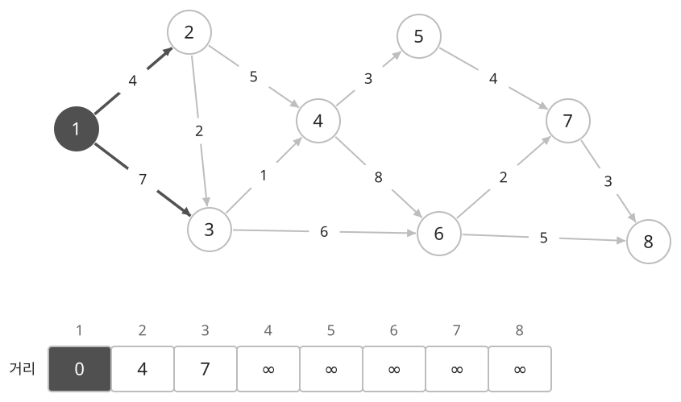
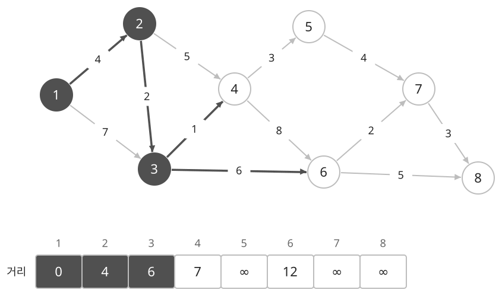
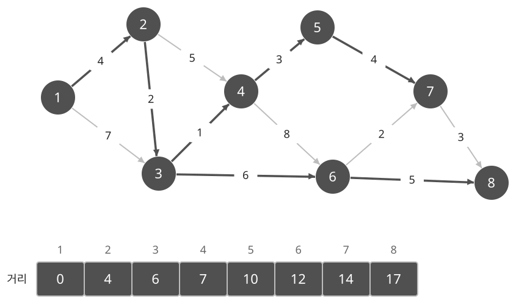

## 개념

다익스트라는 간선의 가중치가 모두 $0$ 이상일 때, 한 시작점에서 다른 모든 정점까지의 최단 거리를 구합니다. 간선마다 이동 비용이 다르고, 한 곳에서 출발하는 최단 경로가 필요할 때 사용합니다. 모든 간선의 비용이 같다면 BFS로 이동 횟수를 구할 수 있습니다.

### 더 짧은 경로로 거리 갱신하기

시작점까지의 거리는 $0$으로 두고, 나머지 정점은 아직 도달하지 못한 상태로 둡니다. 정점 $u$까지 현재 찾은 거리를 $d(u)$, $u$에서 $v$로 가는 간선의 가중치를 $w$라고 하면 $u$를 거쳐 $v$까지 가는 비용은 $d(u)+w$입니다. 이 값이 기존의 $d(v)$보다 작으면 거리를 바꿉니다. 더 짧은 경로를 찾을 때마다 저장된 거리를 갱신하는 방식입니다.

아래는 정점 $8$개와 방향 간선 $12$개가 있는 그래프입니다. 시작점은 $1$입니다. 간선 위에는 비용을, 아래 표에는 현재 기록한 거리를 표시합니다. 진한 정점은 거리가 확정된 정점이고, 진한 간선은 현재 찾은 경로의 직전 간선입니다. $\infty$는 아직 경로를 찾지 못한 상태입니다.

$1$의 간선을 확인하면 $2$까지 $4$, $3$까지 $7$을 기록합니다.

현재 거리가 가장 작은 $2$를 선택합니다. $2\to3$을 거치면 비용은 $4+2=6$이므로 $3$의 거리를 $7$에서 $6$으로 바꿉니다. $4$까지는 $4+5=9$를 기록합니다.

다음에는 거리 $6$인 $3$을 선택합니다. $3\to4$를 거치면 $6+1=7$이므로 $4$의 거리를 다시 $9$에서 $7$로 줄입니다. $6$까지는 $6+6=12$를 기록합니다.

이어서 $4,5,6,7,8$ 순서로 거리를 확정합니다. $4$에서 $6$으로 가는 비용은 $7+8=15$이므로 이미 기록한 $12$를 바꾸지 않습니다. $6$을 처리할 때는 $8$까지 $12+5=17$을 기록합니다. 이처럼 각 간선을 지나는 비용과 기존 거리를 비교하여 더 작은 값을 유지합니다.

### 가장 가까운 정점부터 선택하는 이유

아직 거리를 확정하지 않은 정점 중 현재 거리가 가장 작은 정점을 선택합니다. 선택한 정점까지의 거리가 $3$이고, 나머지 후보의 거리가 모두 $3$ 이상이라면 나머지 후보를 거쳐 돌아오는 경로도 비용이 $3$ 이상입니다. 간선 비용이 $0$ 이상이므로 이동을 추가한다고 비용이 줄어들지 않기 때문입니다. 따라서 선택한 정점의 거리를 확정할 수 있습니다.

음수 간선이 있으면 이 근거가 성립하지 않습니다. $S\to A$가 $2$, $S\to B$가 $5$, $B\to A$가 $-4$이면 처음에는 $A$가 더 가까워 보이지만, $B$를 거치는 비용은 $5-4=1$입니다. 이런 그래프에서는 벨만–포드를 사용해 음수 간선을 처리할 수 있습니다.

### 우선순위 큐와 경로 복원

매번 모든 정점을 살펴보며 가장 가까운 후보를 찾는 대신, 거리가 작은 정점을 먼저 꺼내는 우선순위 큐에 거리와 정점을 함께 넣습니다. 더 짧은 경로를 찾으면 새 후보를 추가하므로 같은 정점의 후보가 여러 개 생길 수 있습니다. 현재 기록보다 큰 거리의 후보는 이미 더 짧은 경로로 대체된 것이므로 건너뜁니다.

실제 경로도 필요하다면 거리가 줄어들 때 직전 정점을 함께 기록합니다. 위 그림에서 $3$의 직전 정점은 $1$에서 $2$로 바뀝니다. 도착점 $8$에서 직전 정점을 따라가면 $8,6,3,2,1$을 얻고, 이를 뒤집으면 최단 경로 $1\to2\to3\to6\to8$이 됩니다.

BFS와 벨만–포드에서도 정점을 발견하거나 거리를 갱신할 때 직전 정점을 저장하여 경로를 복원할 수 있습니다. 플로이드–워셜에서는 정점 쌍마다 다음에 갈 정점이나 경유 정점을 저장합니다.

정점과 간선이 많아 모든 간선을 여러 차례 확인하기 어려운 문제에서도 우선순위 큐를 사용하는 다익스트라를 고려할 수 있습니다. 적용 전에 가중치가 모두 $0$ 이상인지 확인합니다.

### 복잡도

정점 수를 $V$, 간선 수를 $E$라고 합니다. 힙에 같은 정점의 후보가 여러 번 들어가는 구현을 기준으로 합니다.

| 연산 | 시간복잡도 | 공간복잡도 |
| --- | --- | --- |
| 최단 거리 계산 | $O((V+E)\log(V+E))$ | 그래프·힙·거리 $O(V+E)$ |
| 경로 복원 | $O(V)$ | 경로 저장 $O(V)$ |

## 예제

### 문제

방향 그래프에서 시작점부터 도착점까지의 최단 거리와 경로를 구하여라.

### 입력

첫째 줄에 정점 수 $N$, 간선 수 $M$, 시작점 $S$, 도착점 $T$가 공백을 사이에 두고 주어진다. $1\le N\le100$; $0\le M\le300$; $1\le S,T\le N$이다.

다음 $M$개 줄에 간선의 시작점 $a$, 끝점 $b$, 가중치 $w$가 공백을 사이에 두고 주어진다. $1\le a,b\le N$; $1\le w\le100$이다. 도착점에 도달할 수 있다면 최단 경로는 하나이다.

### 출력

도착점에 도달할 수 있으면 첫째 줄에 최단 거리를 출력한다. 둘째 줄에 시작점부터 도착점까지 경로의 정점 번호를 순서대로 공백을 사이에 두고 출력한다. 도달할 수 없으면 첫째 줄에 `-1`을 출력한다.
