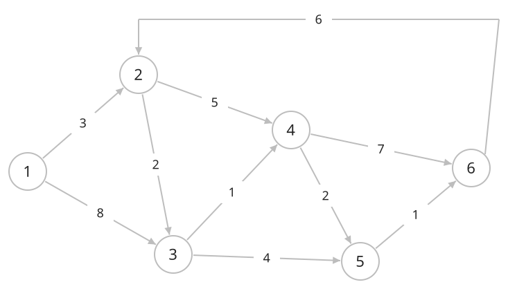
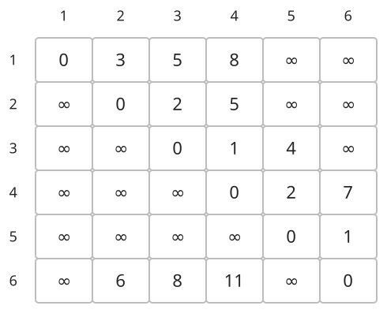
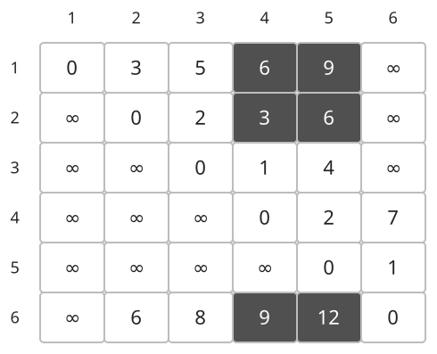

## 개념

플로이드–워셜은 모든 시작점과 도착점 쌍의 최단 거리를 한 번에 구합니다. 다익스트라와 벨만–포드가 한 시작점에서의 거리를 구하는 것과 달리, 결과를 정점 수만큼의 행과 열을 가진 거리 표로 만듭니다. 여러 출발지와 도착지에 대한 질문이 반복될 때 이 표에서 답을 바로 찾을 수 있습니다.

### 경유 정점을 하나씩 허용하기

처음에는 직접 연결된 간선의 비용을 기록합니다. 같은 두 정점을 잇는 간선이 여러 개이면 가장 작은 비용을 사용하고, 자기 자신까지의 거리는 $0$으로 둡니다. 직접 연결되지 않은 정점 쌍은 아직 도달하지 못한 상태입니다.

정점 $i$에서 $j$까지 현재 구한 거리를 $d(i,j)$라고 하겠습니다. 이제 정점 $k$를 중간에 거치는 경로를 추가로 고려합니다. 기존 경로와 $i\to k\to j$ 경로 중 더 짧은 쪽을 선택합니다.

$$d(i,j)=\min\bigl(d(i,j),\ d(i,k)+d(k,j)\bigr).$$

아래는 정점 $6$개와 방향 간선 $10$개가 있는 그래프입니다. $6\to2$가 있어 여러 정점을 돌아오는 경로도 있습니다. 각 간선 위의 수는 비용입니다.

거리 표의 행은 출발점, 열은 도착점입니다. 정점 $1,2$까지 경유를 허용한 상태에서는 $1\to2\to3$의 비용 $3+2=5$, $1\to2\to4$의 비용 $3+5=8$을 기록합니다. $\infty$는 현재 허용된 경유 정점으로는 경로를 찾지 못한 상태입니다.

이제 정점 $3$도 경유할 수 있게 합니다. $1$에서 $3$까지의 거리 $5$와 $3\to4$의 비용 $1$을 더하면 $6$입니다. 따라서 $1$행 $4$열이 $8$에서 $6$으로 줄어듭니다. $2$행 $4$열도 $5$에서 $2+1=3$으로 줄어듭니다.

또한 $1,2,6$에서 $3$을 거쳐 $5$로 가는 경로를 새로 찾습니다. 진한 칸은 이번 단계에서 값이 줄어든 칸입니다. 하나의 경유 정점을 추가하면 여러 출발지·도착지 쌍의 거리가 함께 바뀔 수 있습니다.

이후 $4,5,6$도 차례로 경유 정점에 포함하면 모든 정점 쌍의 최단 거리를 얻습니다.

두 구간 중 하나라도 도달할 수 없다면 그 경유 경로를 만들 수 없습니다.

### 경유 정점의 순서가 중요한 이유

정점을 $1$번부터 차례대로 경유지로 허용합니다. $k$번째 단계가 시작될 때는 중간 정점으로 $1$번부터 $k-1$번까지 사용할 수 있는 최단 거리가 준비되어 있습니다.

새 경로는 $k$를 거치지 않거나, $k$를 거치는 두 경우로 나뉩니다. 전자는 기존 거리이고, 후자는 $i$에서 $k$까지와 $k$에서 $j$까지의 거리를 합한 값입니다. 따라서 위 식으로 두 경우를 비교하면 $k$번까지 경유할 수 있는 최단 거리를 얻습니다.

한 경유 정점에 대해 모든 출발지·도착지 쌍을 갱신한 뒤 다음 경유 정점으로 넘어갑니다. 이 단계 순서를 유지하도록 경유 정점에 대한 반복을 가장 바깥에 둡니다.

### 정점 수와 계산량

정점 수를 $V$라고 하면 경유 정점, 출발지, 도착지를 각각 $V$개씩 살펴보므로 총 $V^3$개의 조합을 확인합니다. 간선 수가 적더라도 이 반복 범위는 같습니다.

| 정점 수 $V$ | 확인하는 조합 수 $V^3$ |
| --- | --- |
| $100$ | $100$만 |
| $300$ | $2700$만 |
| $500$ | $1$억 $2500$만 |
| $1000$ | $10$억 |

대회에서는 정점이 수백 개 정도인 모든 쌍 최단 거리 문제에서 먼저 고려할 수 있습니다. $500$개라면 이미 $1$억 회가 넘는 반복이므로 시간 제한과 사용 언어를 함께 확인해야 합니다. 특히 Python은 같은 정점 수에서도 반복문의 실행 시간이 C++과 다를 수 있습니다. $500$은 통과를 보장하는 고정 기준이 아닙니다.

출발지가 하나뿐이거나, 큰 희소 그래프에서 일부 출발지의 거리만 필요하다면 필요한 출발지에서의 거리만 계산하면 됩니다. 가중치가 $0$ 이상인 경우에는 필요한 출발지마다 다익스트라를 실행하는 방법과 비교합니다.

### 음수 간선과 알고리즘 선택

플로이드–워셜은 음수 간선도 처리합니다. 다만 음수 사이클을 거치는 경로는 반복할수록 비용이 줄어들어 유한한 최단 거리가 없습니다. 계산 후 $d(i,i)<0$인 정점이 있다면, 자기 자신으로 돌아오면서 비용이 줄어드는 음수 사이클이 있다는 뜻입니다.

| 알고리즘 | 구하는 거리 | 가중치 조건과 특징 | 주로 확인할 입력 조건 |
| --- | --- | --- | --- |
| BFS | 한 시작점에서 각 정점까지 | 모든 간선의 비용이 같을 때 이동 횟수 계산 | 정점 수와 간선 수 |
| 다익스트라 | 한 시작점에서 각 정점까지 | 가중치가 모두 $0$ 이상 | 필요한 출발지 수, 정점 수와 간선 수 |
| 벨만–포드 | 한 시작점에서 각 정점까지 | 음수 간선 처리, 도달 가능한 음수 사이클 판별 | 정점 수와 간선 수의 곱 |
| 플로이드–워셜 | 모든 정점 쌍 사이 | 음수 간선 처리, 저장된 표에서 두 정점 사이의 거리 조회 | 정점 수의 세제곱과 거리 표 크기 |

### 복잡도

정점 수를 $V$라고 합니다. 정점 수가 작은 그래프의 모든 쌍 거리가 필요할 때 사용합니다.

| 연산 | 시간복잡도 | 공간복잡도 |
| --- | --- | --- |
| 모든 쌍 최단 거리 | $O(V^3)$ | 거리 표 $O(V^2)$ |

## 예제

### 문제

방향 그래프의 모든 정점 쌍에 대해 최단 거리를 구하여라.

### 입력

첫째 줄에 정점 수 $N$과 간선 수 $M$이 공백을 사이에 두고 주어진다. $1\le N\le50$; $0\le M\le200$이다.

다음 $M$개 줄에 간선의 시작점 $a$, 끝점 $b$, 가중치 $w$가 공백을 사이에 두고 주어진다. $1\le a,b\le N$; $1\le w\le100$이다. 같은 두 정점을 잇는 간선이 여러 개 주어질 수 있다.

### 출력

$N$개 줄에 거리 표를 출력한다. $i$번째 줄에는 정점 $i$에서 정점 $1$부터 $N$까지의 최단 거리를 번호 순서대로 공백을 사이에 두고 출력한다. 도달할 수 없는 정점의 거리는 `-1`, 자신까지의 거리는 `0`으로 출력한다.
