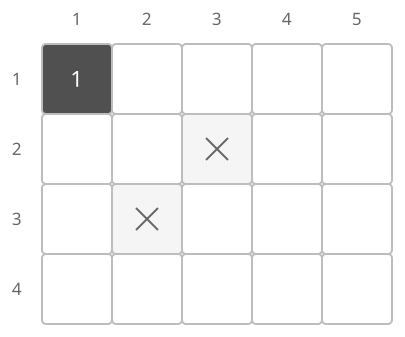
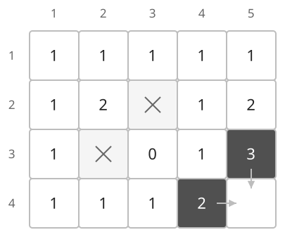
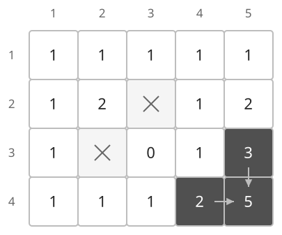

## 개념

이동 방향이 오른쪽과 아래쪽으로 제한된 격자에서는 현재 칸의 답을 위쪽과 왼쪽 칸의 답으로 구할 수 있습니다.

### 각 칸까지 가는 경로 수

$D_{i,j}$를 시작점에서 $(i,j)$까지 오는 경로 수로 정의합니다. 이동 가능한 칸이면 위에서 내려오는 경로와 왼쪽에서 오는 경로를 더합니다.

$$D_{i,j}=D_{i-1,j}+D_{i,j-1}.$$

벽의 값은 $0$입니다. 시작점은 $1$로 설정하고, 격자 밖에서 오는 경우는 $0$으로 처리합니다. 행과 열을 작은 번호부터 확인하면 필요한 두 상태가 먼저 계산됩니다.

도착 직전의 이동은 위에서 내려오거나 왼쪽에서 들어오는 두 경우뿐입니다. 두 경우의 마지막 간선이 다르므로 경로가 중복되지 않아 두 경로 수를 더할 수 있습니다.

### 벽이 있는 격자에서 값 채우기

다음 $4\times5$ 격자에서 $(1,1)$부터 $(4,5)$까지 이동하겠습니다. $(2,3)$과 $(3,2)$는 벽입니다. 그림의 X는 벽, 빈칸은 아직 계산하지 않은 칸이며, 숫자는 해당 칸까지 오는 경로 수입니다.

첫 행은 오른쪽으로만, 첫 열은 아래쪽으로만 도달하므로 각각 $1$가지입니다. $(2,2)$는 위쪽 $(1,2)$와 왼쪽 $(2,1)$에서 각각 $1$가지씩 도달하여 $1+1=2$가 됩니다.

$(3,3)$은 이동 가능한 칸이지만 위쪽 $(2,3)$과 왼쪽 $(3,2)$가 모두 벽입니다. 따라서 경로 수는 $0+0=0$입니다. 이동 가능한 칸도 시작점에서 도달할 수 없으면 $0$으로 남습니다.

행마다 왼쪽부터 계산하면 마지막 칸을 채우기 직전의 상태는 다음과 같습니다. 진한 두 칸은 도착점으로 들어오는 위쪽 칸과 왼쪽 칸입니다.

도착점 $(4,5)$에는 $(3,5)$에서 아래로 내려오는 $3$가지와 $(4,4)$에서 오른쪽으로 이동하는 $2$가지가 있습니다. 마지막 이동 방향이 달라 서로 겹치지 않으므로 $D_{4,5}=3+2=5$입니다.

오른쪽과 아래쪽으로만 이동하므로 먼저 계산한 위·왼쪽 상태가 현재 칸에 다시 의존하지 않습니다. 자유롭게 네 방향으로 이동해 이전 칸으로 돌아올 수 있는 문제라면 같은 계산 순서를 적용할 수 있는지 별도로 확인해야 합니다. 최소 이동 횟수를 구하는 격자 문제에서는 BFS를 사용할 수 있습니다.

### 복잡도

행 수를 $R$, 열 수를 $C$라고 합니다. 경로에 점수가 있다면 최소·최대 점수를 기록하는 상태로 확장할 수 있습니다.

| 연산 | 시간복잡도 | 공간복잡도 |
| --- | --- | --- |
| 격자 DP | $O(RC)$ | 격자·DP 표 $O(RC)$ |

## 예제

### 문제

왼쪽 위에서 오른쪽 아래까지 오른쪽 또는 아래쪽으로만 이동하는 경로의 수를 구하여라.

### 입력

첫째 줄에 행 수 $R$과 열 수 $C$가 공백을 사이에 두고 주어진다. $1\le R,C\le10$이다.

다음 $R$개 줄에 길이가 $C$인 문자열이 주어진다. 각 문자열은 `0`과 `1`이 공백 없이 나열된 형태이다. `1`은 이동 가능한 칸, `0`은 벽이다. 시작 칸과 도착 칸은 `1`이다.

### 출력

가능한 경로 수를 출력한다.
