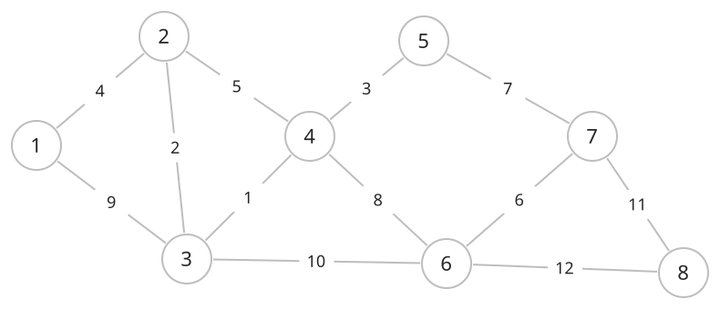
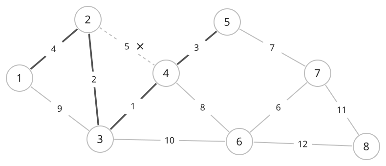
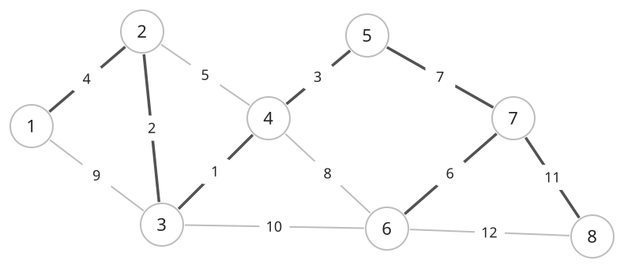

## 개념

### 최소 신장 트리 구성

크루스칼 알고리즘은 무방향 그래프의 간선을 가중치가 작은 순서대로 확인하여 최소 신장 트리를 만듭니다. 모든 정점을 연결하면서 선택한 간선의 가중치 합을 최소로 합니다.

처음에는 각 정점을 별개의 연결 요소로 둡니다. 간선의 양 끝점이 서로 다른 연결 요소에 속하면 간선을 선택하고 두 요소를 합칩니다. 같은 요소에 속하면 해당 간선을 추가할 때 사이클이 생기므로 건너뜁니다. 같은 요소인지 확인하고 합치는 연산에는 DSU를 사용합니다.

정점 수가 $V$일 때 $V-1$개의 간선을 선택하면 신장 트리가 완성됩니다. 그래프가 연결되어 있지 않으면 모든 정점을 연결하는 신장 트리를 만들 수 없습니다.

최소 신장 트리는 모든 정점을 연결하는 전체 비용을 최소화합니다. 특정 시작점에서 각 정점까지 가장 짧게 가는 경로를 구하는 문제와는 목적이 다릅니다.

### 간선을 선택하고 사이클을 제외하는 과정

아래 그래프에는 정점이 $8$개, 간선이 $12$개 있습니다. 진한 간선은 선택한 간선입니다. 처음에는 각 정점이 별개의 집합입니다.

가중치가 작은 순서로 $(3,4):1$, $(2,3):2$, $(4,5):3$, $(1,2):4$를 선택합니다. 이제 $1,2,3,4,5$가 같은 집합입니다. 다음 간선 $(2,4):5$를 추가하면 $2\to3\to4\to2$ 사이클이 생기므로 제외합니다. 점선과 ×가 이 간선을 나타냅니다.

$(6,7):6$을 선택한 뒤 $(5,7):7$로 두 집합을 합칩니다. 가중치 $8,9,10$인 간선은 이미 같은 집합에 속한 정점을 이으므로 제외합니다. 마지막으로 $(7,8):11$을 선택하면 모든 정점이 연결됩니다.

선택한 간선은 $7$개이고 가중치 합은 $1+2+3+4+6+7+11=34$입니다.

### 가중치가 작은 간선을 먼저 선택하는 이유

서로 다른 두 연결 요소를 잇는 간선 중 가중치가 가장 작은 간선을 선택합니다. 어떤 최소 신장 트리가 이 간선을 사용하지 않는다면, 이 간선을 추가해서 생기는 사이클에서 두 요소를 잇는 다른 간선을 제거할 수 있습니다. 추가한 간선의 가중치가 제거한 간선의 가중치 이하이므로 전체 비용이 늘어나지 않습니다.

### 복잡도

정점 수를 $V$, 간선 수를 $E$라고 합니다. 경로 압축과 크기 기준 합치기를 적용한 DSU를 사용합니다.

| 연산 | 시간복잡도 | 공간복잡도 |
| --- | --- | --- |
| 간선 정렬 | $O(E\log E)$ | 간선 $O(E)$ |
| DSU로 간선 선택 | $O(E\alpha(V))$ | DSU $O(V)$ |

## 예제

### 문제

무방향 그래프의 최소 신장 트리 가중치 합을 구하여라.

### 입력

첫째 줄에 정점 수 $N$과 간선 수 $M$이 공백을 사이에 두고 주어진다. $1\le N\le100$; $0\le M\le300$이다.

다음 $M$개 줄에 간선의 양 끝점 $a,b$와 가중치 $w$가 공백을 사이에 두고 주어진다. $1\le a,b\le N$; $1\le w\le100$이다.

### 출력

최소 신장 트리의 가중치 합을 출력한다. 모든 정점을 연결할 수 없으면 `IMPOSSIBLE`을 출력한다.
