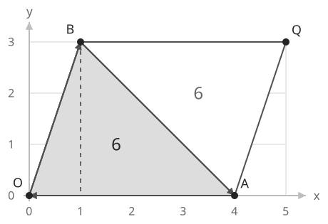
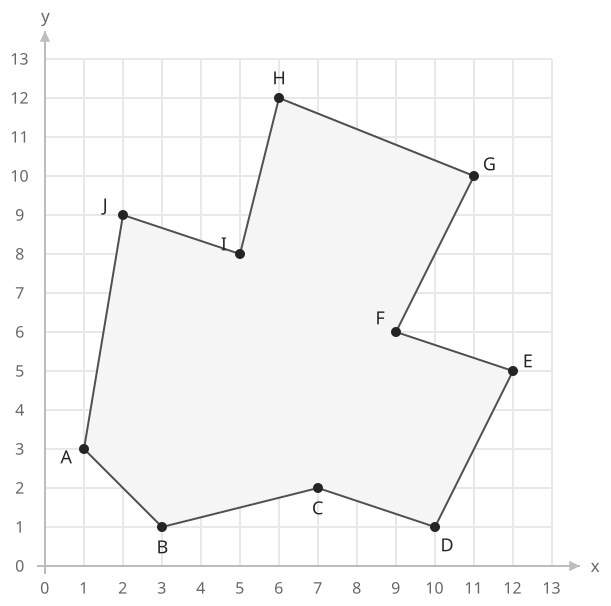
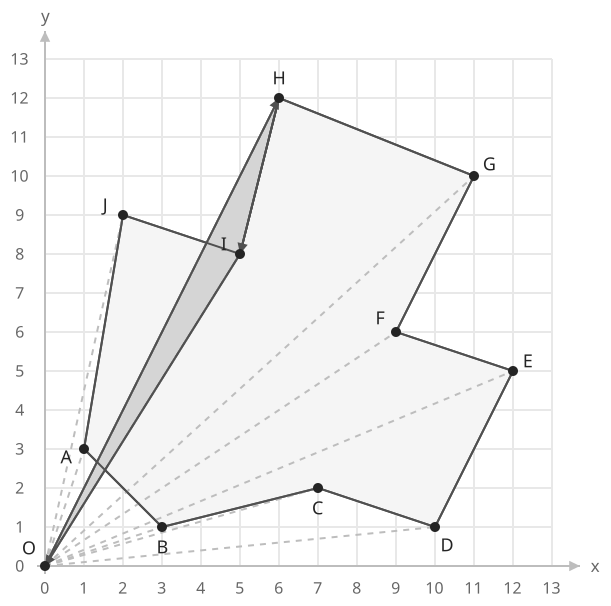

## 개념

### 꼭짓점의 외적 합

다각형의 꼭짓점이 경계를 따라 순서대로 주어지면 신발끈 공식으로 넓이를 구할 수 있습니다. 꼭짓점을 $(x_0,y_0),\ldots,(x_{N-1},y_{N-1})$이라고 하고 마지막 다음 점을 첫 점으로 연결합니다.

$$
\text{넓이}=\frac{1}{2}\left|\sum_{i=0}^{N-1}(x_i y_{i+1}-y_i x_{i+1})\right|
$$

각 항은 원점과 인접한 두 꼭짓점으로 만든 삼각형의 부호 있는 넓이의 두 배입니다. 작은 예제로 한 항의 의미를 확인하겠습니다.

### 외적 한 항과 삼각형 넓이

원점 $O=(0,0)$과 인접한 두 꼭짓점 $A=(4,0)$, $B=(1,3)$을 생각하겠습니다. 아래 그림에서 회색 부분이 삼각형 $OAB$이고, $Q=(5,3)$까지 연결한 전체 도형은 평행사변형입니다. 점선은 높이 $3$을 나타냅니다.

평행사변형의 넓이는 밑변과 높이를 곱한 $4\times3=12$입니다. 선분 $AB$가 이 도형을 같은 넓이의 두 삼각형으로 나누므로 삼각형 $OAB$의 넓이는 $12/2=6$입니다.

변 $AB$에 해당하는 외적 한 항도 $x_Ay_B-y_Ax_B=4\times3-0\times1=12$입니다. 따라서 이 항은 삼각형 넓이 $6$의 두 배입니다. 그림의 $O\to A\to B$는 반시계 방향이므로 부호는 양수입니다.

이번에는 같은 두 꼭짓점을 $B\to A$ 순서로 읽겠습니다. 도형의 크기는 같지만, 연결 순서는 $O\to B\to A$로 바뀝니다.

외적은 $x_By_A-y_Bx_A=1\times0-3\times4=-12$입니다. 실제 삼각형 넓이는 여전히 $6$이며, 시계 방향에 음수를 붙여 부호 있는 넓이를 $-6$으로 계산합니다. 즉 외적은 넓이의 크기와 연결 방향을 함께 나타냅니다.

### 여러 변의 외적 더하기

각 변에 대해 위와 같이 만든 부호 있는 삼각형 넓이를 더하면 다각형 내부의 넓이가 남습니다. 꼭짓점이 시계 방향인지 반시계 방향인지에 따라 합의 부호가 달라지므로, 합을 모두 구한 뒤 절댓값을 취하고 $2$로 나눕니다.

이 공식은 변끼리 교차하지 않는 단순 다각형에 적용합니다. 볼록 다각형과 오목 다각형 모두 계산할 수 있습니다.

정수 좌표로 이루어진 다각형의 넓이는 정수 또는 정수에 $0.5$를 더한 값입니다. 넓이의 두 배를 먼저 정수로 계산하면 마지막에 소수 부분을 정할 수 있습니다.

다음은 안쪽으로 들어간 꼭짓점 $C,F,I$가 있는 $10$각형입니다. 꼭짓점은 $A\to B\to C\to D\to E\to F\to G\to H\to I\to J\to A$ 순서로 연결합니다.

각 변의 두 끝점으로 계산한 외적은 다음과 같습니다. 좌표를 원점에 맞추거나 다각형을 볼록하게 바꾸지 않고, 주어진 순서 그대로 계산합니다.

| 변 | 시작점 | 끝점 | 외적 |
| --- | --- | --- | --- |
| $AB$ | $(1,3)$ | $(3,1)$ | $-8$ |
| $BC$ | $(3,1)$ | $(7,2)$ | $-1$ |
| $CD$ | $(7,2)$ | $(10,1)$ | $-13$ |
| $DE$ | $(10,1)$ | $(12,5)$ | $38$ |
| $EF$ | $(12,5)$ | $(9,6)$ | $27$ |
| $FG$ | $(9,6)$ | $(11,10)$ | $24$ |
| $GH$ | $(11,10)$ | $(6,12)$ | $72$ |
| $HI$ | $(6,12)$ | $(5,8)$ | $-12$ |
| $IJ$ | $(5,8)$ | $(2,9)$ | $29$ |
| $JA$ | $(2,9)$ | $(1,3)$ | $-3$ |

예를 들어 변 $HI$의 외적은 $6\times8-12\times5=-12$입니다. 원점 $O$와 만든 삼각형 $OHI$는 시계 방향이므로 부호 있는 넓이가 $-6$입니다. 아래 그림은 원점과 꼭짓점을 연결하고, 이 삼각형을 진한 회색으로 표시한 것입니다.

외적을 모두 더하면 $153$이므로 넓이는 $153/2=76.5$입니다. 꼭짓점을 반대 순서로 읽으면 합이 $-153$이 되고, 절댓값을 취한 넓이는 같습니다.

원점과 각 변으로 만든 삼각형을 더할 때, 다각형 밖으로 겹쳐 나온 부분은 반대 방향의 삼각형에서 음의 넓이로 빠집니다. 그래서 원점이 내부에 있지 않거나 다각형이 오목해도 부호를 유지해서 합하면 실제 넓이가 남습니다. 각 항마다 절댓값을 취하면 이런 상쇄가 사라지므로 모두 더한 뒤 마지막에 절댓값을 취합니다.

이 방법에는 경계를 따라 나열된 꼭짓점 순서가 필요합니다. 점들이 임의의 순서로 주어졌다면 그 순서로 연결한 도형이 무엇인지부터 확인해야 합니다.

### 복잡도

꼭짓점 수를 $N$이라고 합니다.

| 연산 | 시간복잡도 | 공간복잡도 |
| --- | --- | --- |
| 다각형 넓이 계산 | $O(N)$ | 꼭짓점 저장 $O(N)$ |

## 예제

### 문제

꼭짓점이 경계를 따라 순서대로 주어지는 다각형의 넓이를 구하여라.

### 입력

첫째 줄에 점의 수 $N$이 주어진다. $3\le N\le100$이다.

다음 $N$개 줄에 각 점의 $x$좌표와 $y$좌표가 공백을 사이에 두고 주어진다. 각 좌표는 $0$ 이상 $100$ 이하의 정수이다. 꼭짓점은 경계를 따라 순서대로 주어진다. 다각형의 넓이는 양수이며 변끼리 교차하지 않는다.

### 출력

넓이를 소수점 아래 한 자리까지 출력한다.
