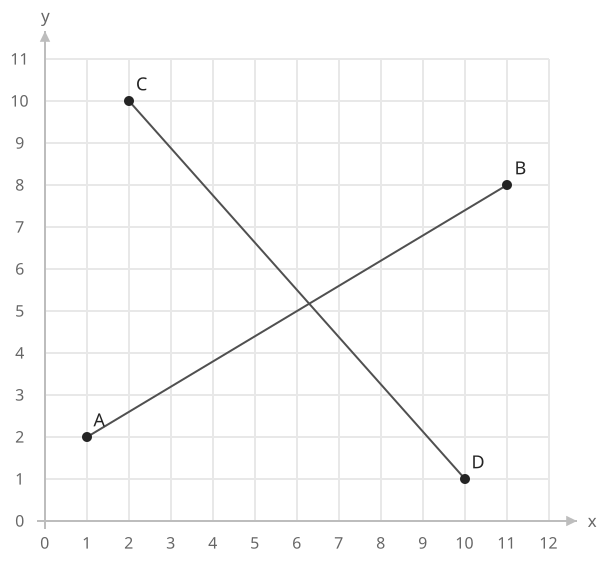
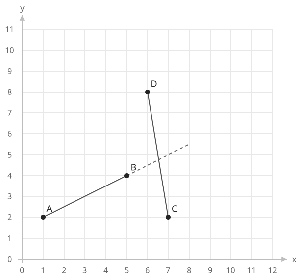
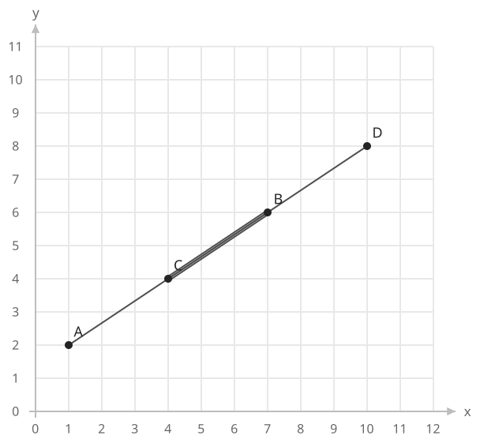

## 개념

### 양쪽 선분에서 방향 확인하기

두 선분 $AB$, $CD$가 교차하는지 확인하려면 다음 두 조건을 함께 확인합니다.

1. 점 $C$, $D$가 직선 $AB$의 서로 반대쪽에 있거나 직선 위에 있습니다.
2. 점 $A$, $B$가 직선 $CD$의 서로 반대쪽에 있거나 직선 위에 있습니다.

각 조건은 CCW 부호로 판별합니다. 양쪽 부호가 반대이거나 하나가 $0$이면 그 조건을 만족합니다. 끝점끼리 닿거나 한 선분의 끝점이 다른 선분 위에 있는 경우도 교차에 포함합니다.

$A=(1,2)$, $B=(11,8)$, $C=(2,10)$, $D=(10,1)$인 두 선분을 확인하겠습니다. 양쪽 선분 모두 기울어져 있고, 교점은 각 선분의 내부에 있습니다.

| 기준 직선 | 확인할 점 | 외적 |
| --- | --- | --- |
| $AB$ | $C$ | $74$ |
| $AB$ | $D$ | $-64$ |
| $CD$ | $A$ | $-73$ |
| $CD$ | $B$ | $65$ |

각 기준 직선에서 두 외적의 부호가 반대이므로 두 선분은 교차합니다. 교점의 좌표를 직접 계산하지 않아도 교차 여부를 알 수 있습니다.

이제 $A=(1,2)$, $B=(5,4)$, $C=(7,2)$, $D=(6,8)$로 바꾸겠습니다. 직선 $AB$에 대한 $C,D$의 외적은 $-12,14$로 부호가 반대입니다. 그러나 직선 $CD$에 대한 $A,B$의 외적은 $36,10$으로 모두 양수입니다. 두 직선이 만나는 위치는 선분 $AB$의 끝점 $B$를 벗어나므로 두 선분은 만나지 않습니다.

### 일직선인 경우

네 점이 한 직선 위에 있으면 방향 값이 모두 $0$입니다. 이때는 두 선분이 실제로 겹치는 구간이 있는지 추가로 확인합니다.

각 선분의 $x$좌표 범위와 $y$좌표 범위를 구합니다. 두 축 모두에서 범위가 겹치면 교차합니다. 범위 $[l_1,r_1]$, $[l_2,r_2]$의 겹침 조건은 다음과 같습니다.

$$
\max(l_1,l_2)\le\min(r_1,r_2)
$$

겹치는 구간의 시작은 두 시작점 중 큰 값이고, 끝은 두 끝점 중 작은 값입니다. 시작이 끝 이하일 때 공통 구간이 존재하므로 위 부등식을 사용합니다. 예를 들어 $[1,4]$와 $[3,6]$은 $[3,4]$에서 겹치고, $[1,2]$와 $[3,4]$는 시작 후보 $3$이 끝 후보 $2$보다 커서 겹치지 않습니다.

아래 그림은 $A=(1,2)$, $B=(7,6)$, $C=(4,4)$, $D=(10,8)$인 경우입니다. 네 점은 같은 비스듬한 직선 위에 있습니다. $x$좌표 범위는 $[1,7]$과 $[4,10]$, $y$좌표 범위는 $[2,6]$과 $[4,8]$입니다. 두 축의 범위가 모두 겹치므로 선분 $CB$가 공통 구간입니다.

방향 부호로 두 선분의 위치 관계를 먼저 확인하고, 일직선에서는 좌표 범위로 실제 길이가 겹치는지 확인합니다. 이 과정을 통해 끝점에서만 닿는 경우와 선분 일부가 포개지는 경우도 함께 판별합니다.

### 복잡도

고정된 두 선분을 기준으로 합니다.

| 연산 | 시간복잡도 | 공간복잡도 |
| --- | --- | --- |
| 선분 교차 판별 | $O(1)$ | 추가 $O(1)$ |

## 예제

### 문제

주어진 두 선분이 교차하는지 판별하여라. 끝점에서 닿거나 일부가 겹치는 경우도 교차로 처리한다.

### 입력

첫째 줄에 첫 번째 선분의 양 끝점 좌표 $x_1,y_1,x_2,y_2$가 공백을 사이에 두고 주어진다. 각 좌표는 $0$ 이상 $100$ 이하의 정수이며 두 끝점은 서로 다르다.

둘째 줄에 두 번째 선분의 양 끝점 좌표가 같은 형식과 범위로 주어진다.

### 출력

교차하면 `YES`, 아니면 `NO`를 출력한다.
