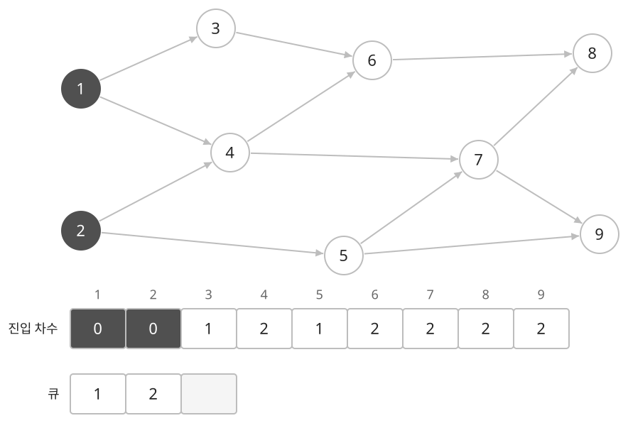
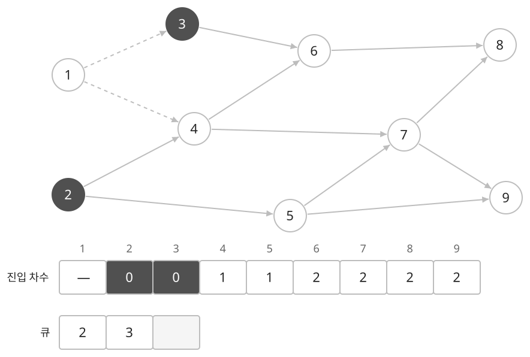
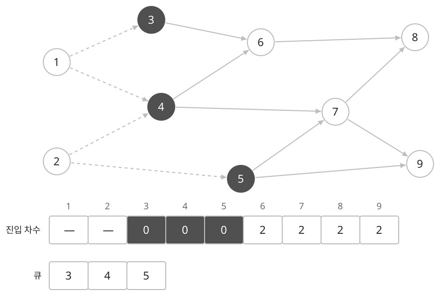
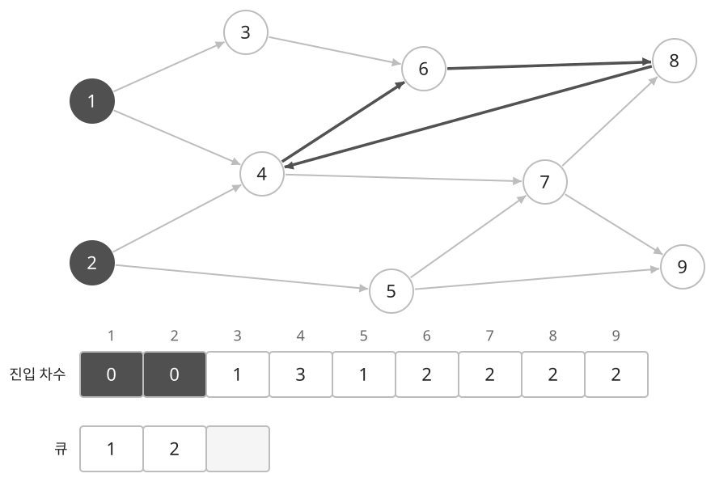
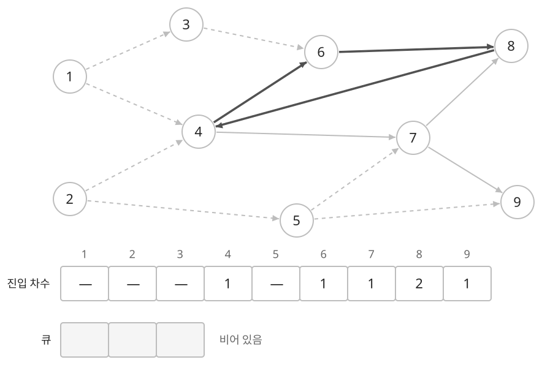

## 개념

### 선후 관계를 지키는 순서

위상 정렬은 방향 간선 $u \to v$마다 $u$가 $v$보다 앞에 오도록 정점을 나열하는 방법입니다. 먼저 끝내야 하는 작업이나 먼저 수강해야 하는 과목이 정해져 있을 때 사용합니다. DAG에서 위상 정렬이 가능하며, 조건을 만족하는 순서는 여러 개일 수 있습니다.

### 진입 차수를 이용한 처리

진입 차수는 그 정점으로 들어오는 간선의 수입니다. 작업 관계에서는 아직 처리해야 할 선행 작업의 개수에 해당합니다. 진입 차수가 $0$인 정점을 큐에 넣고, 하나씩 꺼내며 나가는 간선을 제거합니다. 간선이 제거되어 진입 차수가 $0$이 된 이웃을 큐에 추가합니다.

아래 그래프에는 정점이 $9$개 있습니다. 진한 정점은 큐에 들어 있는 처리 후보입니다. 아래 표는 남은 진입 차수이고, 점선은 처리하면서 제거한 간선입니다. 처음에는 들어오는 간선이 없는 $1,2$를 큐에 넣습니다.

$1$을 처리하면 $1\to3$, $1\to4$를 제거합니다. $3$의 진입 차수는 $0$이 되어 큐에 들어가지만, $4$에는 $2\to4$가 남아 있으므로 진입 차수가 $1$입니다. 큐는 앞에서부터 $2,3$입니다.

$2$를 처리하면 $2\to4$, $2\to5$도 제거합니다. $4,5$의 진입 차수가 모두 $0$이 되어 큐는 $3,4,5$가 됩니다. 이후 같은 과정을 반복하면 $1,2,3,4,5,6,7,8,9$ 순서로 모든 정점을 처리할 수 있습니다.

후보를 일반 큐에 넣으면 추가된 순서로 처리합니다. 후보 중 번호가 가장 작은 정점을 먼저 선택하려면 최소 우선순위 큐를 사용합니다.

### 처리한 정점 수로 방향 사이클 판별하기

진입 차수로 위상 정렬을 수행하면 방향 그래프의 사이클 유무도 판별할 수 있습니다. 큐가 빌 때까지 처리한 정점 수를 $C$, 전체 정점 수를 $V$라고 하면 다음과 같습니다.

| 처리 결과 | 판정 |
| --- | --- |
| $C=V$ | 모든 정점을 처리했으므로 방향 사이클이 없습니다. |
| $C<V$ | 처리할 수 없는 정점이 남았으므로 방향 사이클이 있습니다. |

사이클 안의 각 정점에는 사이클의 이전 정점에서 들어오는 간선이 있습니다. 그 이전 정점을 먼저 처리해야 간선을 제거할 수 있지만, 모든 정점이 같은 조건으로 서로를 기다리므로 진입 차수가 $0$이 되지 않습니다.

앞의 그래프에 $8\to4$를 추가하겠습니다. 진한 간선 $4\to6\to8\to4$가 방향 사이클을 이룹니다. 그래도 $1,2$의 진입 차수는 $0$이므로 일부 정점은 처리할 수 있습니다.

$1,2,3,5$를 처리한 뒤에는 큐가 비게 됩니다. $4$는 $8$을, $6$은 $4$를 기다립니다. $8$도 $6,7$이 처리되기를 기다리므로 남은 간선을 제거할 시작점이 없습니다. 처리한 정점 수는 $4$이고 전체는 $9$이므로 사이클이 있다고 판정합니다.

처리되지 않은 정점이 모두 사이클에 속하는 것은 아닙니다. 그림의 $9$는 사이클에 속하지 않지만, 처리되지 않은 $7$에서 간선이 들어오므로 함께 남습니다. 이 방법으로는 사이클의 존재를 판별하며, 사이클을 이루는 정점 목록을 바로 얻는 것은 아닙니다.

반대로 사이클이 없는 유한 방향 그래프에는 진입 차수가 $0$인 정점이 존재합니다. 그런 정점이 없다고 가정하고 선행 정점을 계속 따라가면 결국 같은 정점을 다시 만나 사이클이 생기기 때문입니다. 따라서 사이클이 없다면 정점을 제거한 뒤에도 다음 후보가 존재하여 모든 정점을 처리할 수 있습니다.

### 복잡도

정점 수를 $V$, 간선 수를 $E$라고 합니다.

| 연산 | 시간복잡도 | 공간복잡도 |
| --- | --- | --- |
| 일반 큐 위상 정렬 | $O(V+E)$ | 그래프 $O(V+E)$, 추가 $O(V)$ |
| 최소 우선순위 큐 위상 정렬 | $O(E+V\log V)$ | 그래프 $O(V+E)$, 추가 $O(V)$ |

## 예제

### 문제

각 작업의 선행 관계가 주어진다. 가능한 작업 중 번호가 가장 작은 작업을 매번 선택하여 전체 작업 순서를 구하여라.

### 입력

첫째 줄에 작업 수 $N$과 선행 관계 수 $M$이 공백을 사이에 두고 주어진다. $1\le N\le100$; $0\le M\le200$이다.

다음 $M$개 줄에 작업 번호 $a,b$가 공백을 사이에 두고 주어진다. $1\le a,b\le N$이다. 작업 $b$를 시작하려면 작업 $a$를 먼저 마쳐야 한다.

### 출력

모든 작업을 수행할 수 있으면 작업 번호를 수행 순서대로 한 줄에 공백을 사이에 두고 출력한다. 수행할 수 없으면 `IMPOSSIBLE`을 출력한다.
