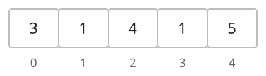
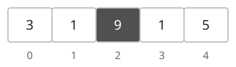
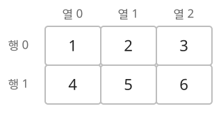
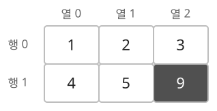

## 개념

배열은 같은 자료형의 원소를 연속된 메모리 공간에 저장하는 자료구조입니다. 생성할 때 크기를 정하고, 인덱스로 원소를 읽거나 수정합니다. 인덱스는 $0$부터 시작합니다.

### 1차원 배열

#### 선언과 초기화

- C++20: `int a[5];`처럼 자료형, 이름, 크기를 적어 기본 배열을 선언합니다. 배열 크기에는 컴파일 시 정해지는 상수를 사용합니다.
- Java 17: `int[] a = new int[n]`으로 만들며 길이는 `a.length`로 읽습니다. 정수 배열의 초기값은 $0$입니다.

#### 원소 접근과 수정

배열 `a`에 $3,1,4,1,5$가 저장되어 있습니다. 각 칸 아래의 숫자는 인덱스입니다. `a[0]`은 첫 번째 원소인 $3$이고, `a[2]`는 세 번째 원소인 $4$입니다.

`a[2] = 9`를 실행하면 인덱스 $2$에 저장된 값이 $4$에서 $9$로 바뀝니다.

#### 시간·공간복잡도

길이가 $N$인 배열을 기준으로 합니다.

| 구분 | 대상 | 복잡도 |
|---|---|---|
| 시간 | 원소 하나 읽기·수정 | $O(1)$ |
| 공간 | 배열 전체 저장 | $O(N)$ |

### 2차원 배열

2차원 배열은 원소를 행과 열로 구분하여 저장합니다. `a[i][j]`에서 `i`는 행 인덱스, `j`는 열 인덱스입니다.

#### 선언과 초기화

각 언어에서 모든 원소가 $0$인 $2$행 $3$열 배열은 다음과 같이 준비합니다.

| 항목 | C++ | Java |
| --- | --- | --- |
| 선언·초기화 | `int a[2][3] = {};` | `int[][] a;`로 선언한 뒤 `a = new int[2][3];`로 초기화 |

#### 원소 접근과 수정

다음 배열은 $2$행 $3$열입니다. `a[0][2]`는 첫 번째 행의 세 번째 값인 $3$이고, `a[1][0]`은 두 번째 행의 첫 번째 값인 $4$입니다.

`a[1][2] = 9`를 실행하면 두 번째 행의 세 번째 원소가 $6$에서 $9$로 바뀝니다.

#### 시간·공간복잡도

$N$행 $M$열 배열을 기준으로 합니다.

| 구분 | 대상 | 복잡도 |
|---|---|---|
| 시간 | 원소 하나 읽기·수정 | $O(1)$ |
| 공간 | 배열 전체 저장 | $O(NM)$ |

## 예제

### 문제

다섯 개의 수가 순서대로 주어집니다. 첫 번째 수와 세 번째 수를 출력한 뒤, 세 번째 수를 $9$로 바꾸고 바뀐 값을 출력합니다.

### 입력

첫째 줄에 10000보다 작은 자연수 다섯 개가 공백으로 구분되어 주어집니다.

### 출력

첫째 줄에 첫 번째 수, 둘째 줄에 변경 전 세 번째 수, 셋째 줄에 변경 후 세 번째 수를 출력합니다.
