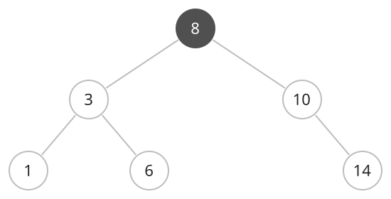

## 개념

BST는 Binary Search Tree의 줄임말로, 키의 대소 관계에 따라 원소를 배치하는 이진 탐색 트리입니다.

서로 다른 키를 저장할 때 각 정점의 왼쪽 서브트리에는 해당 키보다 작은 키를, 오른쪽 서브트리에는 큰 키를 저장합니다. 이 조건은 모든 정점에 적용됩니다.

### 탐색과 순서

찾는 키가 현재 정점의 키보다 작으면 왼쪽, 크면 오른쪽 자식으로 이동합니다. 같은 키를 만나면 탐색을 마칩니다. 왼쪽 서브트리, 현재 정점, 오른쪽 서브트리 순서로 읽으면 키가 오름차순으로 나옵니다.

중복 키는 개수를 함께 저장하거나 한쪽에 배치하는 등 처리 규칙을 정합니다.

### 시간·공간복잡도

정점 수를 $N$, 트리의 높이를 $H$라고 합니다. 탐색·삽입·삭제는 높이에 비례하는 $O(H+1)$ 시간이 걸립니다. 균형을 유지하면 $O(\log N)$, 한쪽으로 치우치면 $O(N)$입니다. 저장 공간은 $O(N)$입니다.
