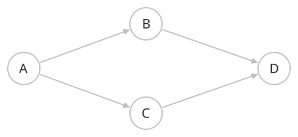

## 개념

DAG는 Directed Acyclic Graph의 줄임말로, 방향 사이클이 없는 방향 그래프입니다.

간선 방향을 따라 이동하면 출발한 정점으로 다시 돌아올 수 없습니다. 어떤 일을 먼저 처리해야 하는지와 같은 선후 관계를 표현합니다.

정점 $1$에서는 $3,4$로 갈라지고, 정점 $4$에서는 $1,2$에서 오는 경로가 합쳐집니다. $6$에는 $3,4$에서, $7$에는 $4,5$에서 간선이 들어옵니다. 이처럼 여러 경로가 합류하더라도 간선 방향을 따라 이전 정점으로 돌아오는 경로가 없으면 DAG입니다.

### 방향 사이클의 유무

그림에는 $4\to6\to8$ 경로가 있습니다. 여기에 $8\to4$ 간선을 추가하면 $4\to6\to8\to4$로 돌아올 수 있어 방향 사이클이 생깁니다. 이렇게 간선 하나를 추가하는 것만으로도 DAG의 조건을 잃을 수 있습니다.

사이클은 간선의 방향을 따라 이동할 수 있는지로 판단합니다. 그림의 $1,3,6,4$는 방향을 무시하면 고리를 이루지만, $6$에서 $4$로 향하는 간선이 없으므로 $1\to3\to6\to4\to1$로 이동할 수 없습니다.

### 진입 차수와 진출 차수

정점이 있는 DAG에는 진입 차수가 $0$인 정점과 진출 차수가 $0$인 정점이 각각 하나 이상 존재합니다.

모든 정점에 들어오는 간선이 있다고 가정하고, 어떤 정점에서 그 간선의 출발 정점을 계속 따라가 보겠습니다. 정점 수가 유한하므로 결국 같은 정점을 다시 만나게 됩니다. 그러면 방향 사이클이 생겨 DAG의 정의에 어긋납니다. 따라서 들어오는 간선이 없는 정점이 존재합니다. 나가는 간선을 계속 따라가는 경우에도 같은 이유로 진출 차수가 $0$인 정점에 도달합니다.

그림에서 진입 차수가 $0$인 정점은 $1,2$이고, 진출 차수가 $0$인 정점은 $8,9$입니다. 선후 관계로 해석하면 $1,2$는 앞서 필요한 일이 없는 정점이고, $8,9$는 뒤에 이어지는 일이 없는 정점입니다.
