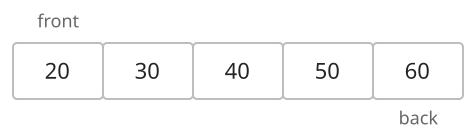
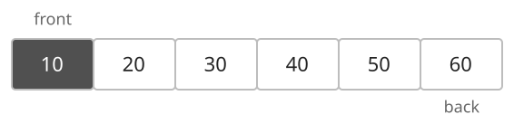
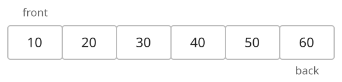
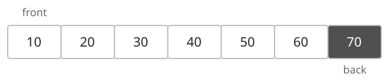
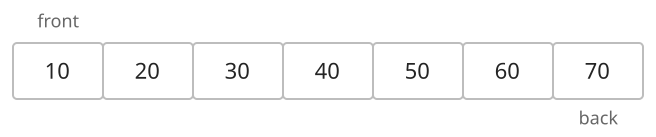
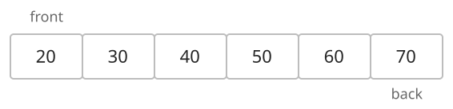

## 개념

덱은 앞과 뒤 양쪽 끝에서 원소를 삽입·삭제하는 자료구조입니다. 앞쪽 끝을 front, 뒤쪽 끝을 back이라고 합니다.

### 앞에 원소 추가

앞에서부터 $20,30,40,50,60$이 들어 있는 덱입니다. front는 $20$, back은 $60$입니다.

앞쪽에 $10$을 넣으면 $20$ 앞에 들어가고, $10$이 새로운 front가 됩니다.

### 뒤에 원소 추가

앞에서부터 $10,20,30,40,50,60$이 들어 있는 덱에 $70$을 추가합니다.

뒤쪽에 $70$을 넣으면 $60$ 뒤에 들어가고, $70$이 새로운 back이 됩니다.

### 앞에서 원소 삭제

앞에서부터 $10,20,30,40,50,60,70$이 들어 있는 덱에서 앞쪽 원소를 꺼냅니다.

front에 있던 $10$이 제거되고, $20$이 새로운 front가 됩니다.

### 뒤에서 원소 삭제

앞에서부터 $20,30,40,50,60,70$이 들어 있는 덱에서 뒤쪽 원소를 꺼냅니다.

back에 있던 $70$이 제거되고, $60$이 새로운 back이 됩니다.

### 언어별 사용법

| 동작 | C++ `deque` | Java `ArrayDeque` | Python `collections.deque` |
|---|---|---|---|
| 앞에 넣기 | `push_front(x)` | `addFirst(x)` | `appendleft(x)` |
| 뒤에 넣기 | `push_back(x)` | `addLast(x)` | `append(x)` |
| 앞에서 꺼내기 | `pop_front()` | `removeFirst()` | `popleft()` |
| 뒤에서 꺼내기 | `pop_back()` | `removeLast()` | `pop()` |

양 끝 연산은 $O(1)$ 또는 분할 상환 $O(1)$이며, 공간복잡도는 $O(N)$입니다.

## 예제

### 문제

처음에 비어 있는 덱에 다음 명령을 순서대로 수행합니다.

| 명령 | 동작 |
|---|---|
| `push_front x` | 맨 앞에 $x$를 추가합니다. |
| `push_back x` | 맨 뒤에 $x$를 추가합니다. |
| `front` | 맨 앞 값을 출력합니다. 빈 덱이면 `EMPTY`를 출력합니다. |
| `back` | 맨 뒤 값을 출력합니다. 빈 덱이면 `EMPTY`를 출력합니다. |
| `pop_front` | 맨 앞 값을 출력하고 제거합니다. 빈 덱이면 `EMPTY`를 출력합니다. |
| `pop_back` | 맨 뒤 값을 출력하고 제거합니다. 빈 덱이면 `EMPTY`를 출력합니다. |
| `size` | 원소 수를 출력합니다. |

### 입력

첫째 줄에 명령 수 $Q$가 주어집니다. $1\le Q\le10\,000$입니다.

다음 $Q$개 줄에 명령이 하나씩 주어집니다. $x$는 10000보다 작은 자연수이며, 명령과 인자는 공백으로 구분됩니다.

### 출력

출력이 필요한 명령의 결과를 한 줄에 하나씩 출력합니다.
