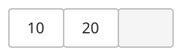
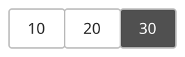
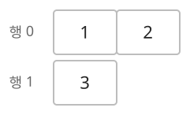
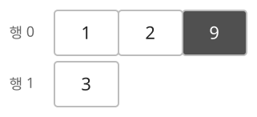

## 개념

동적 배열은 원소 수에 따라 저장 공간을 조절하는 배열입니다. C++의 `vector`, Java의 `ArrayList`, Python의 `list`가 대표적입니다.

### 1차원 동적 배열

#### 크기와 용량

현재 원소 수를 크기, 확보한 저장 공간을 용량이라고 합니다. 뒤에 원소를 추가할 때 용량이 충분하면 새 값만 기록합니다. 용량이 가득 차면 더 큰 공간을 확보하고 기존 값을 옮깁니다.

다음 동적 배열에는 $10,20$이 저장되어 있습니다. 원소 수는 $2$이고 용량은 $3$이므로 한 칸이 비어 있습니다.

뒤에 $30$을 추가하면 비어 있던 칸에 $30$이 저장되어 크기가 $3$이 됩니다.

#### 선언과 초기화

| 항목 | C++ | Java | Python |
| --- | --- | --- | --- |
| 선언 | `vector<int> v;` | `ArrayList<Integer> lst;` | 대입으로 생성 |
| 빈 배열 초기화 | 선언 시 빈 배열 생성 | `lst = new ArrayList<>();` | `lst = []` |
| 원소가 $N$개인 배열 초기화 | `v.assign(n, 0);` | `lst = new ArrayList<>(Collections.nCopies(n, 0));` | `lst = [0] * n` |

#### 접근과 크기 조절

| 연산 | C++ | Java | Python |
| --- | --- | --- | --- |
| 뒤에 추가 | `v.push_back(x)` | `lst.add(x)` | `lst.append(x)` |
| 인덱스로 읽기 | `v[i]` | `lst.get(i)` | `lst[i]` |
| 뒤에서 제거 | `v.pop_back()` | `lst.remove(lst.size()-1)` | `lst.pop()` |
| 크기 확인 | `v.size()` | `lst.size()` | `len(lst)` |

Java의 `ArrayList<Integer>`에서 `remove(i)`는 인덱스 $i$의 원소를 지웁니다. 값으로 지우려면 `remove(Integer.valueOf(x))`를 사용합니다. C++은 마지막 값을 `back()`으로 읽은 뒤 `pop_back()`으로 제거합니다.

#### 시간·공간복잡도

원소 수 $N$, 확보한 용량 $C$를 기준으로 합니다.

| 구분 | 대상 | 복잡도 |
|---|---|---|
| 시간 | 원소 하나 읽기·수정, 크기 확인 | $O(1)$ |
| 시간 | 끝에 원소 추가 | 최악 $O(N)$, 분할 상환 $O(1)$ |
| 시간 | 끝에서 원소 제거 | 분할 상환 $O(1)$ |
| 시간 | 가운데 원소 삽입·삭제 | $O(N)$ |
| 공간 | 확보한 배열 전체 | $O(C)$ |

### 2차원 동적 배열

2차원 동적 배열은 각 행을 동적 배열로 저장하는 구조입니다. 바깥 배열의 크기가 행의 수이고, 각 행의 크기가 해당 행의 열의 수입니다. 행을 추가하거나 제거할 수 있으며, 각 행의 길이도 독립적으로 조절할 수 있습니다.

다음 배열의 첫 번째 행에는 $1,2$가, 두 번째 행에는 $3$이 저장되어 있습니다.

첫 번째 행의 뒤에 $9$를 추가하면 그 행의 길이가 $3$으로 늘어납니다.

#### 선언과 초기화

모든 값이 $0$인 $n$행 $m$열 배열을 만듭니다.

| 항목 | C++ | Java | Python |
| --- | --- | --- | --- |
| 선언 | `vector<vector<int>> v;` | `ArrayList<ArrayList<Integer>> lst;` | 대입으로 생성 |
| 초기화 | `v.assign(n, vector<int>(m, 0));` | `lst = new ArrayList<>();` 실행 후 각 행을 추가 | `lst = [[0] * m for _ in range(n)]` |

Java는 `lst.add(new ArrayList<>(Collections.nCopies(m, 0)));`를 $n$번 실행하여 행을 추가합니다. 각 행은 별도의 배열로 생성합니다.

#### 접근과 크기 조절

`i`는 행 인덱스, `j`는 열 인덱스입니다.

| 동작 | C++ | Java | Python |
| --- | --- | --- | --- |
| 원소 읽기 | `v[i][j]` | `lst.get(i).get(j)` | `lst[i][j]` |
| 원소 수정 | `v[i][j] = x;` | `lst.get(i).set(j, x);` | `lst[i][j] = x` |
| 행의 수 | `v.size()` | `lst.size()` | `len(lst)` |
| 특정 행의 길이 | `v[i].size()` | `lst.get(i).size()` | `len(lst[i])` |
| 특정 행의 끝에 추가 | `v[i].push_back(x);` | `lst.get(i).add(x);` | `lst[i].append(x)` |
| 특정 행의 끝에서 제거 | `v[i].pop_back();` | `lst.get(i).remove(lst.get(i).size() - 1);` | `lst[i].pop()` |
| 빈 행 추가 | `v.push_back(vector<int>());` | `lst.add(new ArrayList<>());` | `lst.append([])` |
| 마지막 행 제거 | `v.pop_back();` | `lst.remove(lst.size() - 1);` | `lst.pop()` |

제거 연산은 대상 원소나 행이 있을 때 수행합니다.

#### 시간·공간복잡도

바깥 배열의 용량 $R$, 각 행의 용량을 합한 값 $C$를 기준으로 합니다.

| 구분 | 대상 | 복잡도 |
|---|---|---|
| 시간 | 원소 하나 읽기·수정 | $O(1)$ |
| 시간 | 특정 행의 끝에 원소 추가 | 분할 상환 $O(1)$ |
| 공간 | 바깥 배열과 모든 행의 저장 공간 | $O(R+C)$ |

## 예제

### 문제

처음에 비어 있는 동적 배열에 다음 명령을 순서대로 수행합니다.

| 명령 | 동작 |
|---|---|
| `append x` | 맨 뒤에 $x$를 추가합니다. |
| `get i` | 인덱스 $i$의 값을 출력합니다. |
| `pop` | 마지막 값을 출력하고 제거합니다. 빈 배열이면 `EMPTY`를 출력합니다. |
| `size` | 원소 수를 출력합니다. |

### 입력

첫째 줄에 명령 수 $Q$가 주어집니다. $1\le Q\le10\,000$입니다.

다음 $Q$개 줄에 명령이 하나씩 주어집니다. $x$는 10000보다 작은 자연수이며, `get`의 인덱스는 현재 배열의 범위 안에서 주어집니다. 명령과 인자는 공백으로 구분됩니다.

### 출력

출력이 필요한 명령의 결과를 한 줄에 하나씩 출력합니다.
