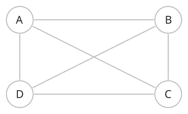
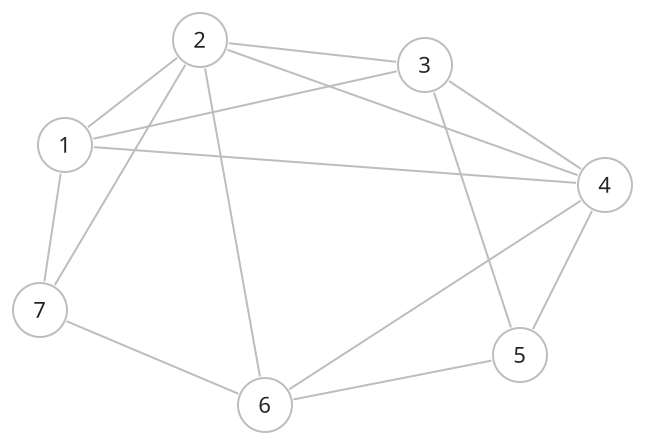
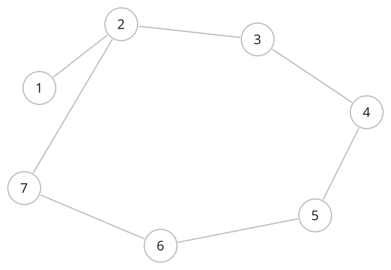

## 개념

아래 세 그림은 같은 $7$개 정점을 같은 위치에 배치하고, 간선의 수를 바꾸어 비교합니다. 선이 교차하는 곳은 원으로 표시된 정점이 있을 때만 연결됩니다.

### 완전 그래프

완전 그래프는 서로 다른 모든 정점 쌍이 간선으로 연결된 단순 무방향 그래프입니다. 정점이 $N$개인 완전 그래프를 $K_N$으로 나타냅니다.

#### 간선 수와 차수

각 정점은 나머지 $N-1$개 정점과 연결되므로 차수는 $N-1$입니다. 간선 하나를 양 끝에서 두 번 세게 되므로 전체 간선 수는 다음과 같습니다.

$$
M=\frac{N(N-1)}{2}.
$$

이는 정점이 $N$개인 단순 무방향 그래프가 가질 수 있는 최대 간선 수입니다.

그림의 각 정점은 다른 $6$개 정점과 연결됩니다. 전체 간선 수는 $7\times6/2=21$개입니다.

### 밀집 그래프

밀집 그래프는 가능한 연결 중 많은 정점 쌍이 실제 간선으로 연결된 그래프입니다. 단순 그래프에서 간선 수 $M$이 $N^2$에 비례하는 규모인 경우가 대표적입니다.

이 그림에는 가능한 $21$개 연결 중 $14$개가 있습니다. 정점 $2$는 나머지 $6$개 정점 중 $5$개와 직접 연결되어 있습니다.

#### 저장 방식

정점 쌍의 연결 여부를 자주 확인할 때는 인접 행렬을 사용할 수 있습니다. 인접 행렬은 $O(N^2)$ 공간을 사용하며 연결 여부를 $O(1)$에 확인합니다.

완전 그래프는 가능한 모든 간선이 존재하는 밀집 그래프입니다. 밀집 그래프는 일부 정점 쌍이 연결되지 않은 경우도 포함합니다.

### 희소 그래프

희소 그래프는 가능한 연결에 비해 실제 간선이 적은 그래프입니다. 정점 수 $N$에 비례하는 정도의 간선 수 $M$을 가진 그래프가 대표적입니다.

이 그림은 $7$개 간선으로 모든 정점을 연결합니다. 정점 $1$은 $2$와만 직접 연결되어 있으므로, 다른 정점으로 이동하려면 $2$를 거쳐야 합니다.

#### 저장 방식

인접 리스트는 실제 연결된 이웃만 저장하므로 희소 그래프를 표현하기에 적합합니다.

| 표현 | 저장 공간 |
|---|---|
| 인접 리스트 | $O(N+M)$ |
| 인접 행렬 | $O(N^2)$ |

희소와 밀집은 가능한 간선 수에 비해 실제 간선이 얼마나 많은지를 나타내는 상대적인 구분입니다.
