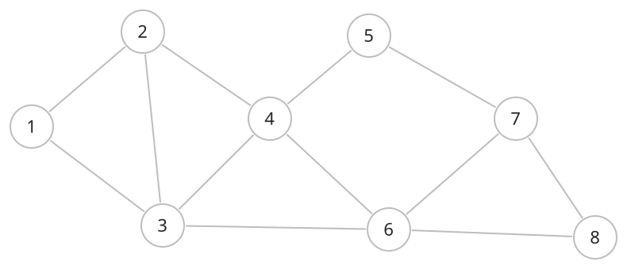
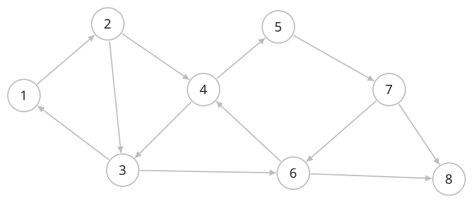

## 개념

### 무방향 그래프

무방향 그래프는 간선으로 연결된 두 정점 사이를 양쪽 방향으로 이동할 수 있는 그래프입니다. 양방향 연결을 표현할 때 사용합니다.

간선 $\{u,v\}$는 $u$에서 $v$로, $v$에서 $u$로 이동할 수 있음을 뜻합니다. 그림에서는 화살표 없는 선으로 표시합니다.

#### 차수와 저장

간선 하나는 양 끝 정점의 차수에 각각 $1$씩 더해집니다. 간선 수가 $M$이면 모든 정점의 차수 합은 $2M$입니다.

인접 리스트에는 간선 하나를 양쪽 정점의 이웃 목록에 각각 저장합니다. 인접 행렬에서는 $(u,v)$와 $(v,u)$의 연결 여부가 같습니다.

### 방향 그래프

방향 그래프는 간선마다 출발점과 도착점이 정해진 그래프입니다. 단방향 연결을 표현할 때 사용합니다.

$u\to v$는 $u$에서 $v$로 향하는 간선입니다. 반대 방향의 연결은 $v\to u$라는 별도의 간선으로 표현합니다.

#### 진입 차수와 진출 차수

| 용어 | 의미 |
|---|---|
| 진입 차수 | 해당 정점으로 들어오는 간선 수 |
| 진출 차수 | 해당 정점에서 나가는 간선 수 |

간선 수가 $M$이면 전체 진입 차수의 합과 전체 진출 차수의 합은 각각 $M$입니다. 인접 리스트에는 출발 정점의 목록에 도착 정점을 저장합니다.
