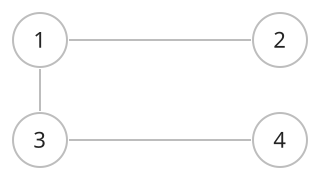
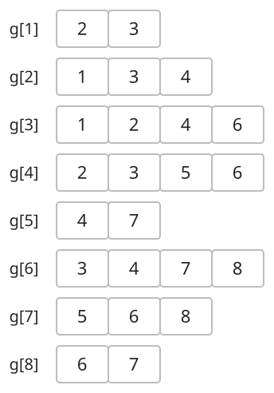

## 개념

그래프는 정점과 정점 사이를 연결하는 간선으로 이루어진 자료구조입니다. 정점 수를 $N$, 간선 수를 $M$으로 나타냅니다.

### 기본 용어

| 용어 | 의미 |
|---|---|
| 정점 | 그래프를 구성하는 대상 |
| 간선 | 두 정점 사이의 연결 |
| 인접 | 두 정점이 간선으로 직접 연결된 관계 |
| 경로 | 간선을 따라 정점을 차례로 잇는 순서 |
| 단순 경로 | 정점을 중복해서 지나지 않는 경로 |
| 사이클 | 시작 정점으로 돌아오는 경로. 시작·끝을 제외한 정점은 중복하지 않습니다. |
| 차수 | 무방향 그래프에서 정점에 연결된 간선 수 |
| 연결 그래프 | 모든 두 정점 사이에 경로가 존재하는 무방향 그래프 |
| 연결 요소 | 서로 경로로 연결된 정점들의 최대 집합 |
| 단순 그래프 | 자기 자신으로 향하는 간선과 중복 간선이 없는 그래프 |

### 저장 방식

인접 행렬은 정점 쌍의 연결 여부를 표로 저장합니다. 인접 리스트는 각 정점에 연결된 이웃을 목록으로 저장합니다. $\deg(u)$는 정점 $u$의 차수입니다.

앞의 그래프에서 정점 $1$의 이웃은 $2,3$이므로 `g[1]`에 두 정점을 저장합니다. 무방향 그래프에서는 간선의 양 끝에서 서로를 이웃으로 기록합니다.

| 표현 | 저장 공간 | 연결 여부 확인 | 한 정점의 이웃 순회 |
|---|---|---|---|
| 인접 행렬 | $O(N^2)$ | $O(1)$ | $O(N)$ |
| 인접 리스트 | $O(N+M)$ | 해당 목록 길이에 비례 | $O(\deg(u))$ |
