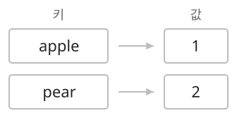
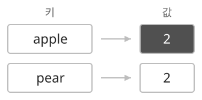

## 개념

맵은 키와 값의 쌍을 저장합니다. 키로 값을 찾으며, 같은 키에 값을 저장하면 기존 값을 갱신합니다.

단어별 등장 횟수, 상품별 가격, 참가 번호별 점수처럼 대상마다 정보를 연결할 때 사용합니다. 키는 정보를 찾는 기준이고, 값은 그 대상에 저장할 정보입니다. 예를 들어 상품명 `apple`을 키로, 가격 $1000$을 값으로 저장하면 상품명을 조회해 가격을 얻습니다.

### 키로 정보 조회

참가 번호별 점수를 저장하는 맵에서는 참가 번호가 키이고 점수가 값입니다.

| 참가 번호(키) | 점수(값) |
|---|---|
| $101$ | $80$ |
| $205$ | $95$ |

번호 $205$로 조회하면 점수 $95$를 얻습니다. 번호 $101$의 점수를 $90$으로 저장하면 그 번호에 연결된 점수가 갱신됩니다. 새 번호 $307$과 점수 $70$을 저장하면 키·값 쌍이 추가됩니다.

각 키에는 값 하나를 연결합니다. 서로 다른 키에 같은 값을 저장할 수 있으므로, 여러 참가자의 점수가 같아도 각각의 번호로 조회할 수 있습니다.

### 등장 횟수 집계

단어별 등장 횟수를 구할 때는 단어를 키로, 횟수를 값으로 저장합니다. 단어를 읽을 때마다 그 단어의 횟수를 $1$ 늘립니다. 처음 읽은 단어는 횟수 $1$로 등록합니다.

다음 맵에는 `apple`이 $1$번, `pear`가 $2$번 등장했다는 정보가 저장되어 있습니다.

`apple`을 한 번 더 읽으면 저장된 횟수 $1$에 $1$을 더해 $2$로 갱신합니다.

서로 다른 단어의 종류를 모을 때는 Set을, 각 단어의 등장 횟수까지 기록할 때는 Map을 사용합니다.

### 언어별 등장 횟수 갱신

`cnt`는 단어별 등장 횟수를 저장하는 맵이고, `s`는 읽은 단어입니다.

| 동작 | C++ | Java | Python |
|---|---|---|---|
| 횟수 $1$ 증가 | `++cnt[s]` | `cnt.put(s, cnt.getOrDefault(s, 0) + 1)` | `cnt[s] = cnt.get(s, 0) + 1` |
| 단어의 등록 여부 | `cnt.contains(s)` | `cnt.containsKey(s)` | `s in cnt` |
| 서로 다른 단어의 수 | `cnt.size()` | `cnt.size()` | `len(cnt)` |

C++의 `cnt[s]`는 새 키에 정수 기본값 $0$을 넣습니다. Java의 `getOrDefault(s, 0)`과 Python의 `get(s, 0)`은 키가 없으면 $0$을 반환합니다. 여기에 $1$을 더해 저장하므로 첫 등장부터 같은 식으로 횟수를 셀 수 있습니다.

### 저장 방식과 복잡도

키로 값을 조회하고 갱신하는 작업에는 해시 맵을 사용합니다. 키를 정렬된 순서로 관리해야 하면 정렬 맵을 사용합니다.

| 종류 | C++ | Java | Python | 기본 연산 |
|---|---|---|---|---|
| 해시 맵 | `unordered_map` | `HashMap` | `dict` | 평균 $O(1)$ |
| 정렬 맵 | `map` | `TreeMap` | `dict`의 키를 `sorted`로 정렬 | 트리 기반 구현은 $O(\log K)$ |

$K$는 키의 수이며, 표의 복잡도는 키 비교·해시 계산 비용을 $O(1)$로 봅니다.

Python에서 키의 사전순으로 출력할 때는 `sorted(cnt.items())`를 사용합니다. 전체 키 문자열의 길이를 $L$이라 하면 저장 공간은 $O(K+L)$입니다.

## 예제

### 문제

여러 개의 단어가 주어진다. 각 단어의 등장 횟수를 구하여라.

### 입력

첫째 줄에 단어 수 $N$이 주어진다. $0\le N\le10\,000$이다.

다음 $N$개 줄에 영어 소문자로 이루어진 단어가 하나씩 주어진다. 각 단어의 길이는 $1$ 이상 $20$ 이하이다.

### 출력

서로 다른 단어마다 단어와 등장 횟수를 공백으로 구분하여 한 줄에 출력한다. 단어의 사전순으로 출력한다. $N=0$이면 아무것도 출력하지 않는다.
