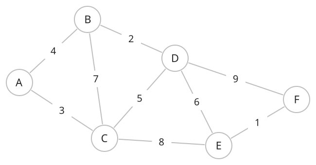
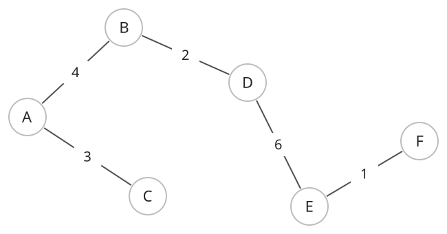

## 개념

신장 트리는 연결된 무방향 그래프에서 모든 정점을 포함하도록 간선을 골라 만든 트리입니다. 모든 정점이 연결되어 있고 사이클이 없어야 합니다. 정점이 $N$개이면 신장 트리의 간선은 $N-1$개입니다.

간선에 가중치가 있으면 어떤 간선을 고르는지에 따라 신장 트리의 가중치 합이 달라집니다. 가능한 신장 트리 중 간선 가중치의 합이 가장 작은 것을 최소 신장 트리(Minimum Spanning Tree, MST)라고 합니다.

### 원래 그래프

다음 그래프에는 정점 $A,B,C,D,E,F$와 간선 $9$개가 있습니다. 간선 옆 숫자는 가중치입니다. 이 그래프의 신장 트리는 간선 $5$개로 정점 $6$개를 모두 연결해야 합니다.

### 최소 신장 트리

원래 그래프에서 $AB,AC,BD,DE,EF$를 선택하면 다음 트리가 됩니다. 이 다섯 간선으로 모든 정점 사이를 이동할 수 있으며, 사이클은 없습니다.

| 선택한 간선 | 가중치 |
|---|---|
| $AB$ | $4$ |
| $AC$ | $3$ |
| $BD$ | $2$ |
| $DE$ | $6$ |
| $EF$ | $1$ |

선택한 간선의 가중치 합은 $4+3+2+6+1=16$입니다. 위 그래프의 모든 정점을 연결하는 신장 트리 중 이보다 작은 합을 갖는 트리는 없으므로, 이 트리가 MST입니다.

여기서 $AB$ 대신 $CD$를 선택해도 모든 정점을 연결하는 신장 트리가 됩니다. 이때 가중치 합은 $5+3+2+6+1=17$입니다. 두 트리 모두 연결 조건을 만족하지만, MST는 가중치 합이 최소인 트리입니다.

### 성질

- 같은 최소 합을 갖는 신장 트리가 여러 개일 수 있습니다.
- 모든 간선의 가중치가 서로 다르면 최소 신장 트리는 하나입니다.

그래프가 여러 연결 요소로 나뉘면 각 요소의 최소 신장 트리를 모은 최소 신장 숲으로 다룹니다. 신장 트리의 간선을 저장하는 공간은 $O(N)$입니다.
