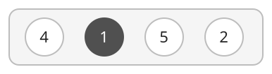
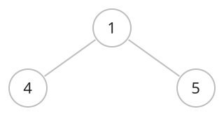
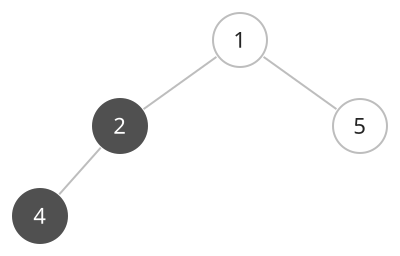
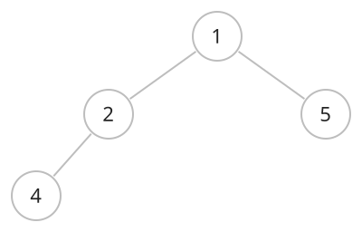
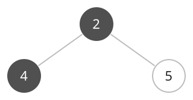

## 개념

우선순위 큐는 저장된 원소 중 우선순위가 가장 높은 원소부터 꺼내는 자료구조입니다. 작은 값이나 큰 값을 먼저 꺼내도록 우선순위를 정할 수 있습니다.

작은 값을 먼저 꺼내는 우선순위 큐에 $4,1,5,2$가 저장되어 있습니다. 진한 원은 다음에 꺼낼 값인 $1$을 나타냅니다.

원소를 하나 꺼내면 가장 작은 값 $1$이 제거됩니다. $4,5,2$가 남으므로 다음에 꺼낼 값은 $2$입니다.

### 힙의 구조

힙은 우선순위 큐를 구현하는 대표적인 자료구조입니다. 이진 힙은 마지막 레벨을 제외한 모든 레벨이 채워지고, 마지막 레벨은 왼쪽부터 채워지는 완전 이진 트리입니다.

#### 최소 힙과 최대 힙

최소 힙은 부모 값이 자식 값 이하인 구조입니다. 루트에 최솟값이 있으므로 작은 값을 먼저 꺼내는 우선순위 큐에 사용합니다.

최대 힙은 부모 값이 자식 값 이상인 구조입니다. 루트에 최댓값이 있으므로 큰 값을 먼저 꺼내는 우선순위 큐에 사용합니다.

같은 부모를 가진 두 자식 중 어느 쪽 값이 더 큰지는 정해져 있지 않습니다.

### 힙에 원소 삽입

최소 힙에 새 원소를 넣는 과정은 다음과 같습니다.

1. 완전 이진 트리의 형태를 유지하도록 다음 빈 자리에 새 원소를 넣습니다.
2. 새 원소가 부모보다 작으면 부모와 위치를 바꿉니다.
3. 부모 값이 현재 값 이하가 되거나 루트에 도달할 때까지 반복합니다.

루트가 $1$, 두 자식이 $4,5$인 최소 힙입니다.

이 힙에 $2$를 삽입하면 새 원소는 $4$의 왼쪽 자식 자리에 들어갑니다. $2$가 부모 $4$보다 작으므로 두 값을 교환합니다. 부모 $1$이 $2$ 이하이므로 삽입을 마칩니다.

### 힙에서 최솟값 제거

최솟값은 루트에서 바로 읽습니다. 최솟값을 제거하는 과정은 다음과 같습니다.

1. 루트의 값을 꺼냅니다.
2. 마지막 원소를 루트로 옮기고 마지막 자리를 없앱니다. 원소가 하나였다면 빈 힙이 됩니다.
3. 두 자식 중 값이 작은 자식과 비교합니다. 자식이 하나면 그 자식과 비교합니다.
4. 현재 값이 그 자식보다 크면 위치를 바꿉니다. 자식이 없거나 부모·자식 조건을 만족할 때까지 반복합니다.

최대 힙은 삽입할 때 부모보다 큰 값을 위로 올리고, 제거할 때 두 자식 중 큰 값과 비교합니다.

삽입을 마친 힙의 최솟값은 루트에 있는 $1$입니다.

루트 $1$을 꺼낸 뒤 마지막 원소 $4$를 루트로 옮깁니다. 두 자식 $2,5$ 중 작은 값 $2$와 비교하여, $4$가 더 크므로 교환합니다. 내려간 $4$에는 자식이 없으므로 제거를 마칩니다.

### 라이브러리 사용법

작은 값을 먼저 꺼내도록 준비하는 방법은 다음과 같습니다.

| 항목 | C++ | Java | Python |
|---|---|---|---|
| 선언 | `priority_queue<int, vector<int>, greater<int>> pq;` | `PriorityQueue<Integer> pq;` | 대입으로 생성 |
| 초기화 | 선언 시 빈 큐 생성 | `pq = new PriorityQueue<>();` | `heap = []` |
| 값 추가 | `pq.push(x)` | `pq.offer(x)` | `heapq.heappush(heap, x)` |
| 최솟값 읽기 | `pq.top()` | `pq.peek()` | `heap[0]` |
| 최솟값 제거 | `pq.pop()` | `pq.poll()` | `heapq.heappop(heap)` |
| 원소 수 | `pq.size()` | `pq.size()` | `len(heap)` |

C++의 `pop()`은 제거만 수행하므로 값을 사용하려면 먼저 `top()`으로 읽습니다. Java의 `poll()`과 Python의 `heappop()`은 제거한 값을 반환합니다. 조회와 제거는 원소가 있을 때 수행합니다.

큰 값을 먼저 꺼내려면 C++은 `priority_queue<int>`를 사용하고, Java는 생성자에 `Comparator.reverseOrder()`를 전달합니다. Python은 값의 부호를 바꿔 저장하고 꺼낸 값의 부호를 되돌리는 방식으로 구현할 수 있습니다.

### 시간·공간복잡도

Python의 `heapq`는 리스트를 힙으로 관리합니다. 삽입과 제거에서 값이 이동하는 경로는 힙의 높이인 $O(\log N)$ 이내입니다.

원소 수 $N$을 기준으로, 이진 힙을 사용하는 우선순위 큐의 복잡도는 다음과 같습니다.

| 연산 | 시간복잡도 |
|---|---|
| 우선순위가 가장 높은 값 읽기 | $O(1)$ |
| 값 추가 | $O(\log N)$, 배열 확장 비용은 분할 상환 |
| 우선순위가 가장 높은 값 제거 | $O(\log N)$ |
| 전체 저장 공간 | $O(N)$ |

## 예제

### 문제

여러 개의 수가 주어진다. 남아 있는 수 중 가장 작은 수를 하나씩 꺼내는 순서대로 출력하여라. 같은 수가 여러 번 주어지면 그 횟수만큼 출력하여라.

### 입력

첫째 줄에 원소 수 $N$이 주어진다. $1\le N\le100\,000$이다.

둘째 줄에 수열의 원소 $a_1,a_2,\ldots,a_N$이 공백을 사이에 두고 주어진다. $1\le a_i<10\,000$이다.

### 출력

수를 꺼내는 순서대로 한 줄에 공백으로 구분하여 출력한다.
