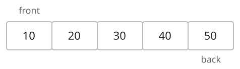
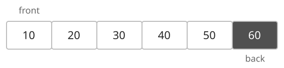
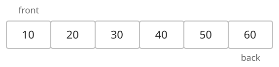
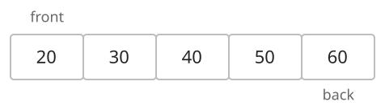

## 개념

큐는 먼저 삽입한 원소를 먼저 제거하는 선입선출(FIFO) 자료구조입니다. 뒤쪽에 원소를 삽입하고 앞쪽에서 원소를 제거합니다.

### 뒤에 원소 추가

앞에서부터 $10,20,30,40,50$이 들어 있는 큐에 $60$을 추가합니다. 앞쪽 끝을 front, 뒤쪽 끝을 back이라고 합니다.

$60$은 back에 있는 $50$ 뒤에 들어갑니다. 새 원소 $60$이 back이 됩니다.

### 앞에서 원소 삭제

$10,20,30,40,50,60$을 차례로 넣은 큐에서 원소를 하나 꺼냅니다.

가장 먼저 넣은 $10$이 제거되고, 다음에 넣은 $20$이 새로운 front가 됩니다.

### 언어별 사용법

| 동작 | C++ `queue` | Java `ArrayDeque` | Python `collections.deque` |
|---|---|---|---|
| 뒤에 넣기 | `q.push(x)` | `q.offerLast(x)` | `q.append(x)` |
| 앞 읽기 | `q.front()` | `q.peekFirst()` | `q[0]` |
| 앞에서 꺼내기 | `q.pop()` | `q.pollFirst()` | `q.popleft()` |
| 크기 | `q.size()` | `q.size()` | `len(q)` |

삽입·삭제는 $O(1)$ 또는 내부 배열 확장에 따른 분할 상환 $O(1)$입니다. 공간복잡도는 $O(N)$입니다.

Python의 `list.pop(0)`은 $O(N)$이므로 큐에는 `deque`를 사용합니다.

## 예제

### 문제

처음에 비어 있는 큐에 다음 명령을 순서대로 수행합니다.

| 명령 | 동작 |
|---|---|
| `push x` | 맨 뒤에 $x$를 추가합니다. |
| `front` | 맨 앞 값을 출력합니다. 빈 큐이면 `EMPTY`를 출력합니다. |
| `pop` | 맨 앞 값을 출력하고 제거합니다. 빈 큐이면 `EMPTY`를 출력합니다. |
| `size` | 원소 수를 출력합니다. |

### 입력

첫째 줄에 명령 수 $N$이 주어집니다. $1\le N\le10\,000$입니다.

다음 $N$개 줄에 명령이 하나씩 주어집니다. $x$는 10000보다 작은 자연수이며, 명령과 인자는 공백으로 구분됩니다.

### 출력

출력이 필요한 명령의 결과를 한 줄에 하나씩 출력합니다.
