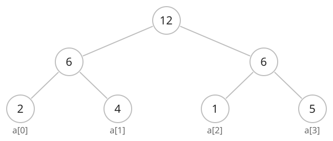
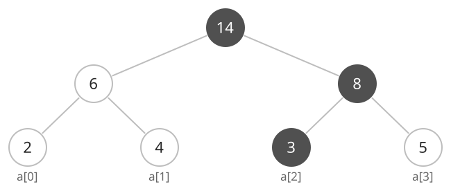

## 개념

세그먼트 트리는 배열의 구간 정보를 트리에 저장합니다. 리프에는 원래 배열의 값을 두고, 부모에는 두 자식 구간의 합을 저장합니다. 루트에는 전체 합을 저장합니다.

배열 $[2,4,1,5]$의 구간 합을 저장한 트리입니다. 리프에는 배열의 값이 저장되고, 두 원소씩 묶은 구간의 합은 각각 $6$입니다. 루트에는 전체 합 $12$가 저장됩니다.

인덱스 $2$의 값을 $3$으로 바꾸면 해당 리프의 값이 $1$에서 $3$으로 바뀝니다. 이 리프를 포함하는 오른쪽 구간의 합은 $8$, 전체 합은 $14$로 갱신됩니다.

$$
\operatorname{tree}[i]=\operatorname{tree}[2i]+\operatorname{tree}[2i+1].
$$

원소 수가 $N$이면 트리 배열은 $4N$칸으로 잡습니다. 루트는 `t[1]`, 노드 `t[k]`의 왼쪽 자식과 오른쪽 자식은 각각 `t[2 * k]`, `t[2 * k + 1]`입니다.

각 노드는 구간 $[s,e)$를 담당합니다. 중간 위치 $m$을 기준으로 왼쪽 자식은 $[s,m)$, 오른쪽 자식은 $[m,e)$를 담당하며, 원소가 하나인 구간이 리프입니다.

### 점 갱신

점 갱신은 바꿀 인덱스가 포함된 자식으로 내려갑니다. 리프에 도착하면 값을 바꾸고, 재귀 호출에서 돌아오면서 두 자식의 합으로 부모 값을 갱신합니다.

### 구간 합

구간 합 질의는 $l$을 포함하고 $r$ 직전까지인 반열린 구간 $[l,r)$의 합을 구합니다. 각 노드가 담당하는 구간과 질의 구간을 비교합니다.

1. 두 구간이 겹치지 않으면 $0$을 반환합니다.
2. 노드의 구간이 질의 구간에 완전히 포함되면 저장된 합을 반환합니다.
3. 일부만 겹치면 두 자식을 재귀 호출하고 반환값을 더합니다.

빈 구간 $[l,l)$의 합은 $0$입니다. 트리 저장 공간은 $O(N)$입니다.

| 연산 | 시간복잡도 |
|---|---|
| 점 갱신으로 원소 $N$개 저장 | $O(N\log N)$ |
| 원소 하나 대입 | $O(\log N)$ |
| 구간 합 질의 | $O(\log N)$ |

## 예제

### 문제

배열에 다음 명령을 순서대로 수행합니다.

| 명령 | 동작 |
|---|---|
| `set i x` | 인덱스 $i$의 값을 $x$로 바꿉니다. |
| `sum l r` | 인덱스 $l$부터 $r$ 직전까지의 합을 출력합니다. |

### 입력

첫째 줄에 배열 길이 $N$과 명령 수 $Q$가 공백으로 구분되어 주어집니다. $1\le N,Q\le10\,000$입니다.

둘째 줄에 배열의 원소 $N$개가 공백으로 구분되어 주어집니다. 초기값과 갱신값 $x$는 10000보다 작은 자연수입니다.

다음 $Q$개 줄에 명령이 하나씩 주어집니다. $0\le i<N$이고 $0\le l\le r\le N$입니다. 명령과 인자는 공백으로 구분됩니다.

### 출력

`sum` 명령마다 구간의 합을 한 줄에 출력합니다. $l=r$이면 $0$을 출력합니다.
