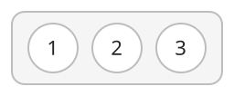

## 개념

집합은 서로 다른 값을 한 번씩 저장하는 자료구조입니다. 같은 값을 다시 넣어도 원소 수는 변하지 않습니다.

같은 값이 여러 번 주어질 때 서로 다른 값만 모으거나, 특정 값이 이미 등록되어 있는지 확인할 때 사용합니다. 예를 들어 참가 번호가 여러 번 기록된 명단에서 실제 참가자 수를 구하려면 번호를 집합에 넣고 원소 수를 셉니다.

### 중복 제거

참가 번호 $1,2,3$이 집합에 등록되어 있습니다.

번호 $3$을 다시 등록하면 이미 같은 값이 있으므로 중복 삽입을 무시합니다.

새 번호 $4$를 등록하면 집합은 $\{1,2,3,4\}$가 되고, 참가자 수는 $4$명이 됩니다.

### 포함 여부 확인

등록된 번호가 $\{1,2,3\}$일 때 번호 $2$의 등록 여부를 조회하면 참, 번호 $4$를 조회하면 거짓입니다. 이처럼 여러 번 들어오는 조회에 대해 값이 집합에 포함되어 있는지 확인할 수 있습니다.

처리한 번호를 기록할 때도 사용합니다. 번호를 하나 읽을 때마다 집합에 있는지 확인하고, 처음 나온 번호이면 처리한 뒤 집합에 넣습니다. 등록을 취소할 때는 해당 번호를 집합에서 삭제합니다.

### 언어별 사용법

| 동작 | C++ | Java | Python |
|---|---|---|---|
| 값 추가 | `st.insert(x)` | `set.add(x)` | `s.add(x)` |
| 포함 여부 확인 | `st.contains(x)` | `set.contains(x)` | `x in s` |
| 값 삭제 | `st.erase(x)` | `set.remove(x)` | `s.discard(x)` |
| 서로 다른 값의 수 | `st.size()` | `set.size()` | `len(s)` |

### 저장 방식과 복잡도

포함 여부 확인과 삽입·삭제가 주된 작업이면 해시 집합을 사용합니다. 원소를 정렬된 순서로 관리해야 하면 정렬 집합을 사용합니다.

원소 수를 $K$라고 할 때, 저장 방식에 따른 연산 비용은 다음과 같습니다.

| 종류 | C++ | Java | Python | 삽입·조회·삭제 |
|---|---|---|---|---|
| 해시 집합 | `unordered_set` | `HashSet` | `set` | 평균 $O(1)$ |
| 정렬 집합 | `set` | `TreeSet` | `set`과 `sorted`로 정렬 결과 생성 | 트리 기반 구현은 $O(\log K)$ |

Python의 `sorted(s)`는 집합 원소를 정렬한 리스트를 반환하며 $O(K\log K)$가 걸립니다.

원소 $K$개에 필요한 공간은 $O(K)$입니다.

## 예제

### 문제

여러 개의 수가 주어집니다. 서로 다른 수가 몇 개인지 구하고, 중복을 제거한 수들을 오름차순으로 출력합니다.

### 입력

첫째 줄에 수의 개수 $N$이 주어집니다. $1\le N\le100\,000$입니다.

둘째 줄에 10000보다 작은 자연수 $N$개가 공백으로 구분되어 주어집니다.

### 출력

첫째 줄에 서로 다른 수의 개수를 출력합니다. 둘째 줄에 그 수들을 오름차순으로 공백으로 구분하여 출력합니다.
