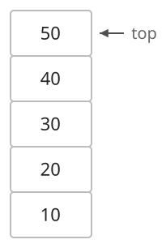
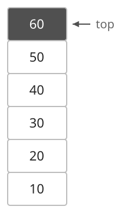
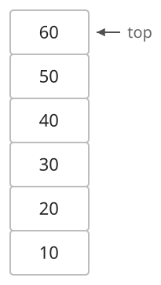

## 개념

스택은 가장 나중에 삽입한 원소를 먼저 제거하는 후입선출(LIFO) 자료구조입니다. 삽입과 제거는 한쪽 끝인 top에서 수행합니다.

### 원소 추가

아래에서부터 $10,20,30,40,50$이 들어 있는 스택에 $60$을 추가합니다. 현재 top은 $50$입니다.

$60$이 $50$ 위에 들어가고, 새 원소 $60$이 top이 됩니다.

### 원소 삭제

$10,20,30,40,50,60$을 차례로 넣은 스택에서 원소를 하나 꺼냅니다.

가장 나중에 넣은 $60$이 제거되고, 바로 아래에 있던 $50$이 새로운 top이 됩니다.

### 언어별 사용법

| 동작 | C++ `stack` | Java `ArrayDeque` | Python `list` |
|---|---|---|---|
| 넣기 | `push(x)` | `push(x)` | `append(x)` |
| 맨 위 읽기 | `top()` | `peek()` | `[-1]` |
| 꺼내기 | `pop()` | `pop()` | `pop()` |
| 빈 상태 확인 | `empty()` | `isEmpty()` | `not st` |

C++의 `pop()`은 제거 동작을 수행하므로 값을 먼저 `top()`으로 읽습니다. Java와 Python의 `pop()`은 꺼낸 값도 반환합니다.

기본 연산은 $O(1)$이며, 내부 배열 크기를 조절하는 구현의 삽입·삭제는 분할 상환 $O(1)$입니다. 원소 $N$개를 저장하는 공간은 $O(N)$입니다. top 조회와 제거는 원소가 있을 때 수행합니다.

## 예제

### 문제

처음에 비어 있는 스택에 다음 명령을 순서대로 수행합니다.

| 명령 | 동작 |
|---|---|
| `push x` | 맨 위에 $x$를 추가합니다. |
| `top` | 맨 위 값을 출력합니다. 빈 스택이면 `EMPTY`를 출력합니다. |
| `pop` | 맨 위 값을 출력하고 제거합니다. 빈 스택이면 `EMPTY`를 출력합니다. |
| `size` | 원소 수를 출력합니다. |

### 입력

첫째 줄에 명령 수 $Q$가 주어집니다. $1\le Q\le10\,000$입니다.

다음 $Q$개 줄에 명령이 하나씩 주어집니다. $x$는 10000보다 작은 자연수이며, 명령과 인자는 공백으로 구분됩니다.

### 출력

출력이 필요한 명령의 결과를 한 줄에 하나씩 출력합니다.
