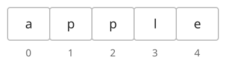
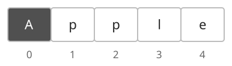

## 개념

문자열은 문자를 순서대로 저장하는 자료구조입니다. 단어, 이름, 괄호로 이루어진 식처럼 문자의 순서가 중요한 데이터를 표현합니다. `apple`은 문자 `a`, `p`, `p`, `l`, `e`가 차례대로 들어 있는 길이 $5$의 문자열입니다. 같은 문자도 서로 다른 위치에 저장할 수 있습니다.

### 문자와 인덱스

각 문자는 인덱스로 접근합니다. `apple`의 인덱스 $0$에는 `a`, 인덱스 $3$에는 `l`이 있습니다.

인덱스 $0$의 문자를 `A`로 바꾸면 `Apple`이 됩니다. 문자열을 바꾸는 방법은 언어에 따라 다릅니다.

### 언어별 표현과 변경

| 항목 | C++ | Java | Python |
| --- | --- | --- | --- |
| 문자열 선언 | `string s = "apple";` | `String s = "apple";` | `s = "apple"` |
| 길이 | `s.size()` | `s.length()` | `len(s)` |
| 한 문자 접근 | `s[i]` | `s.charAt(i)` | `s[i]` |
| 한 문자 변경 | `s[i] = 'A';` | `StringBuilder`의 `setCharAt(i, 'A')` | `list(s)`로 만든 리스트의 원소 변경 |
| 두 문자열 비교 | `s == t` | `s.equals(t)` | `s == t` |

C++의 `string`은 저장된 문자를 직접 바꿀 수 있습니다. Java의 `String`과 Python의 `str`은 생성한 문자열의 내용을 직접 바꿀 수 없습니다. 여러 문자를 수정할 때 Java는 `StringBuilder`, Python은 문자 리스트를 만들어 수정한 뒤 문자열로 변환합니다. Java의 `==`는 두 변수가 같은 객체를 가리키는지 비교하므로, 문자열 내용은 `equals`로 비교합니다.

문자열의 사전 순서는 앞에서부터 처음으로 다른 문자를 비교하여 정합니다. 영어 소문자 문자열 `cat`과 `car`는 세 번째 문자 `t`와 `r`에서 순서가 결정되므로 `car`가 먼저입니다. 한 문자열이 다른 문자열의 접두사라면 짧은 문자열이 먼저입니다. 따라서 `app`은 `apple`보다 앞섭니다. 접두사는 문자열의 처음부터 연속해서 가져온 부분입니다.

### 부분 문자열 추출

문자열에서 필요한 구간을 잘라 새로운 문자열을 만듭니다. `abcdef`의 위치 $1$부터 $4$ 직전까지 추출하면 `bcd`입니다.

| 동작 | C++ | Java | Python |
| --- | --- | --- | --- |
| 구간 [l, r) 추출 | `s.substr(l, r - l)` | `s.substring(l, r)` | `s[l:r]` |

C++ `substr`의 두 번째 인자는 길이입니다. Java `substring`의 두 번째 인자와 Python 슬라이스의 끝 인덱스는 포함하지 않는 끝 위치입니다.

### 기본 검색

문자열 안에 다른 문자열이 처음 등장하는 위치를 찾습니다. 시작 위치를 함께 지정하면 그 위치부터 검색합니다.

| 동작 | C++ | Java | Python |
| --- | --- | --- | --- |
| 처음 등장하는 위치 | `s.find(t)` | `s.indexOf(t)` | `s.find(t)` |
| p부터 검색 | `s.find(t, p)` | `s.indexOf(t, p)` | `s.find(t, p)` |
| 찾지 못한 결과 | `string::npos` | `-1` | `-1` |

C++의 검색 결과는 `string::npos`와 비교한 뒤 인덱스로 사용합니다. 시작 위치마다 비교하는 방법과 반복 비교를 줄이는 원리는 [KMP](/algorithm-notes/notes/algorithms/kmp/)에서 다룹니다.

### 분리·결합·치환

문자열을 구분자로 나누거나, 여러 문자열 사이에 구분자를 넣어 합칠 수 있습니다.

| 동작 | C++ | Java | Python |
| --- | --- | --- | --- |
| 두 문자열 결합 | `s + t` | `s + t` | `s + t` |
| 공백으로 단어 분리 | `istringstream`에서 `>>` 반복 | `StringTokenizer` | `s.split()` |
| 쉼표로 분리 | `getline(ss, t, ',')` 반복 | `s.split(",", -1)` | `s.split(',')` |
| 단어 사이 공백으로 결합 | 반복하며 구분자와 단어 추가 | `String.join(" ", lst)` | `' '.join(lst)` |
| 위치 p부터 k개 문자 교체 | `s.replace(p, k, t)` | 앞부분 + t + 뒷부분 | `s[:p] + t + s[p+k:]` |
| 문자열의 모든 일치 부분 치환 | 검색 위치를 갱신하며 교체 | `s.replace(old, next)` | `s.replace(old, new)` |

Java의 `split`은 구분자를 정규식으로 해석합니다. 점처럼 정규식에서 특별한 의미가 있는 문자를 구분자로 쓸 때는 이스케이프가 필요합니다. `-1`은 맨 끝의 빈 항목도 보존합니다. C++에서 `getline`을 반복하는 방식은 맨 끝 구분자 뒤의 빈 항목을 별도로 처리해야 합니다.

Java와 Python의 문자열은 변경 연산의 결과로 새 문자열을 만듭니다. 많은 조각을 결합할 때는 Java의 `StringBuilder`, Python의 `join`으로 모아서 처리합니다.

### 복잡도

문자열 길이를 $N$, 추출 길이를 $K$, 결합 결과 길이를 $L$이라고 합니다. 다음 표는 영어 알파벳으로 이루어진 문자열을 기준으로 합니다. 문자열 전체를 비교할 때는 앞의 문자가 같으면 다음 문자까지 확인해야 합니다.

| 연산 | 시간복잡도 | 추가 공간복잡도 |
| --- | --- | --- |
| 길이 조회·한 문자 접근 | $O(1)$ | $O(1)$ |
| C++ 문자열의 한 문자 변경 | $O(1)$ | $O(1)$ |
| Java의 StringBuilder·Python 문자 리스트 생성 | $O(N)$ | $O(N)$ |
| 생성한 StringBuilder·문자 리스트의 한 문자 변경 | $O(1)$ | $O(1)$ |
| 수정한 내용을 문자열로 변환 | $O(N)$ | $O(N)$ |
| 같은 길이의 두 문자열 내용 비교 | 최악 $O(N)$ | $O(1)$ |
| 부분 문자열 생성 | $O(K)$ | 결과 $O(K)$ |
| 한 구분자로 분리 | $O(N)$ | 결과 $O(N)$ |
| 모아 둔 조각 결합 | $O(L)$ | 결과 $O(L)$ |

## 예제

### 문제

문자열에서 $L$번째 문자부터 $R$번째 문자까지 추출하여라.

### 입력

첫째 줄에 영어 소문자로 이루어진 문자열 $S$가 주어진다. 길이는 $1$ 이상 $100$ 이하이다.

둘째 줄에 추출할 구간의 시작 번호 $L$과 끝 번호 $R$이 공백을 사이에 두고 주어진다. $1\le L\le R\le\lvert S\rvert$이다. $\lvert S\rvert$는 문자열 $S$의 길이이며, 문자 번호는 $1$부터 시작한다.

### 출력

추출한 문자열을 출력한다.
