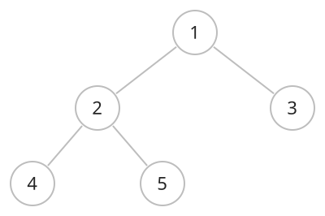

## 개념

트리는 모든 정점이 연결되어 있고 사이클이 없는 무방향 그래프입니다. 두 정점 사이의 단순 경로는 하나이며, 정점이 $N$개이면 간선은 $N-1$개입니다.

한 정점을 루트로 정하면 부모·자식 관계가 생깁니다. 루트에서 어떤 정점으로 내려올 때 바로 앞에 만나는 정점이 부모입니다.

다음 트리는 정점 $1$을 루트로 정한 모습입니다. 정점 $2,3$의 부모는 $1$이고, 정점 $4,5$의 부모는 $2$입니다. 루트 $1$의 깊이는 $0$, 정점 $2,3$의 깊이는 $1$, 정점 $4,5$의 깊이는 $2$입니다.

### 기본 용어

| 용어 | 의미 |
|---|---|
| 루트 | 계층의 시작 정점 |
| 부모·자식 | 간선으로 연결된 위·아래 정점 |
| 형제 | 같은 부모를 가진 정점들 |
| 조상 | 부모를 따라 루트 쪽으로 올라가며 만나는 정점 |
| 자손 | 자식을 따라 아래로 내려가며 만나는 정점 |
| 깊이 | 루트에서 해당 정점까지의 간선 수 |
| 리프 | 자식이 없는 정점 |
| 서브트리 | 한 정점과 그 자손들로 이루어진 트리 |
| 높이 | 해당 정점에서 가장 먼 자손까지의 간선 수 |

루트의 깊이와 리프의 높이는 $0$입니다. 이진 트리는 각 정점이 최대 두 자식을 갖는 트리입니다.

### 저장 방식

부모 배열은 각 정점의 부모를, 자식 목록은 각 정점의 자식들을 저장합니다. 무방향 간선을 그대로 인접 리스트에 저장할 수도 있습니다.

부모 배열의 부모 조회는 $O(1)$, 자식 목록의 순회는 자식 수에 비례합니다. 부모 배열과 전체 자식 목록의 공간복잡도는 $O(N)$입니다.
