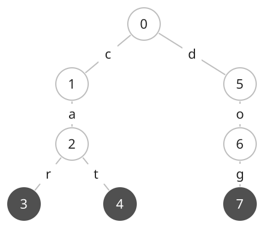
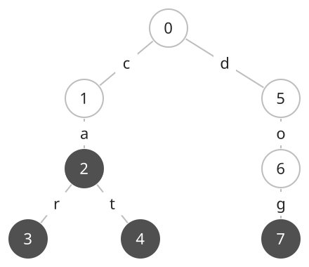

## 개념

트라이는 문자열을 문자 단위의 경로로 저장하는 트리입니다. 루트에서 시작하여 간선에 적힌 문자를 차례로 읽으면 하나의 접두사가 됩니다. 같은 접두사를 가진 문자열은 그 접두사에 해당하는 경로를 공유합니다.

단어 목록에서 특정 단어가 있는지 확인하거나, 특정 접두사로 시작하는 단어가 있는지 찾을 때 사용합니다. 예를 들어 `ca`로 시작하는 단어를 찾을 때는 모든 단어의 앞부분을 비교하는 대신 루트에서 `c`, `a` 두 간선을 따라갑니다.

### 문자열 저장과 끝 표시

`car`, `cat`, `dog`를 저장하면 `car`와 `cat`은 `c → a` 경로를 공유하고, 마지막 문자에서 갈라집니다. 아래 그림에서 $0$은 루트이며, 진한 노드는 단어가 끝나는 위치입니다. 간선의 문자를 루트부터 읽습니다.

`ca`를 추가할 때는 이미 있는 `c → a` 경로를 따라간 뒤, 도착한 노드에 단어의 끝을 표시합니다. 새 간선을 만들 필요가 없습니다. 이 표시가 있어야 접두사 `ca`와 저장된 단어 `ca`를 구분할 수 있습니다.

### 삽입과 검색

삽입은 루트에서 시작합니다. 다음 문자에 해당하는 자식이 있으면 이동하고, 없으면 새 노드와 간선을 만든 뒤 이동합니다. 마지막 문자를 처리한 노드에 끝 표시를 남깁니다. 같은 단어를 다시 넣으면 같은 경로와 끝 표시를 사용합니다.

단어 검색도 문자를 하나씩 따라갑니다. 도중에 필요한 간선이 없으면 저장되지 않은 단어입니다. 모든 문자를 따라간 뒤에는 끝 표시까지 확인합니다. 위의 첫 그림에서 `car`는 끝 표시가 있어 검색에 성공하지만, `ca`는 경로만 있으므로 단어 검색에 실패합니다.

접두사 검색은 해당 경로가 있는지만 확인합니다. 첫 그림에서도 `ca` 경로가 있으므로 `ca`로 시작하는 단어가 존재합니다. 자동 완성 후보를 모두 구하려면 해당 노드에서 아래로 탐색하여 끝 표시가 있는 경로를 모을 수 있습니다.

### 자식을 저장하는 방법과 복잡도

영어 소문자만 저장한다면 각 노드에 $26$개 자식 칸을 둡니다. 문자 `a`부터 `z`를 $0$부터 $25$에 대응시켜 다음 노드를 바로 찾습니다. 등장하는 문자의 종류가 많으면 필요한 자식만 맵에 저장하는 방법도 있습니다.

문자열의 길이를 $L$, 저장하는 문자열 길이의 합을 $S$, 만들어진 노드 수를 $V$라고 합니다. 루트를 포함해 $V\le S+1$입니다. 아래는 노드마다 크기 $26$의 자식 배열을 사용하는 경우입니다.

| 연산·저장 대상 | 시간복잡도 | 공간복잡도 |
| --- | --- | --- |
| 길이 $L$의 문자열 삽입 | $O(L)$ | 새 노드 최대 $O(26L)$ |
| 단어·접두사 검색 | $O(L)$ | 추가 공간 $O(1)$ |
| 모든 문자열 삽입·전체 저장 | $O(S+26V)$ | $O(26V)$ |

$26$은 고정된 상수이므로 전체 공간은 $O(V)$로도 나타냅니다. 다만 실제로는 노드마다 자식 칸 $26$개를 저장하므로, 입력 문자열의 총길이를 확인하여 배열 크기를 정해야 합니다.

## 예제

### 문제

단어 $N$개를 저장한 뒤 질의 $Q$개에 답하여라. 질의 `word s`는 단어 `s`가 저장되어 있는지 묻고, 질의 `prefix s`는 `s`로 시작하는 단어가 있는지 묻는다.

### 입력

첫째 줄에 양의 정수 $N$과 $Q$가 공백을 사이에 두고 주어진다. $1\le N,Q\le100$이다.

다음 $N$개 줄에 단어가 하나씩 주어진다. 이어지는 $Q$개 줄에 질의 종류와 문자열 $s$가 공백을 사이에 두고 주어진다. 질의 종류는 `word` 또는 `prefix`이다.

모든 단어와 질의 문자열은 영어 소문자로 이루어져 있으며, 길이는 $1$ 이상 $20$ 이하이다.

### 출력

각 질의에 대해 조건을 만족하면 `YES`, 만족하지 않으면 `NO`를 한 줄에 하나씩 출력한다.
