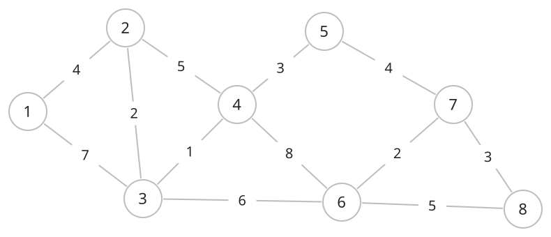

## 개념

가중치 그래프는 간선마다 거리, 비용, 시간 등의 값을 저장하는 그래프입니다. 간선 $(u,v)$의 가중치를 $w(u,v)$로 나타냅니다.

### 가중치와 경로 비용

경로의 비용은 일반적으로 그 경로에 포함된 간선 가중치의 합입니다. 가중치의 의미와 허용 범위는 문제에서 정합니다.

방향 그래프와 무방향 그래프 모두 가중치를 가질 수 있습니다. 방향 그래프에서는 $u\to v$와 $v\to u$의 가중치가 서로 다를 수 있습니다.

### 저장 방식

인접 리스트에는 이웃 정점과 가중치를 쌍으로 저장합니다. 인접 행렬에는 정점 쌍에 해당하는 가중치를 저장하고, 간선이 없는 상태를 별도로 구분합니다. 가중치 $0$인 간선도 존재할 수 있습니다.
